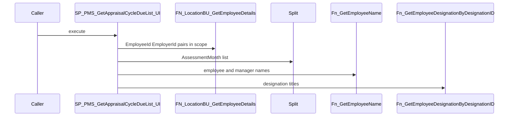
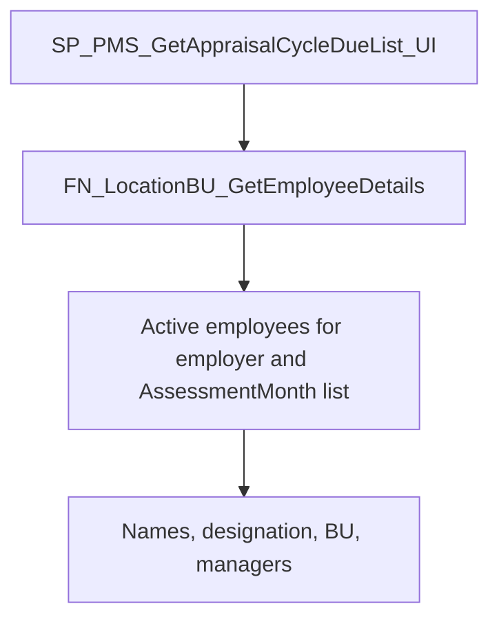

# SP_PMS_GetAppraisalCycleDueList_UI

## What it does

Returns active employees for an employer whose `TEmployeeInfo.AssessmentMonth` is in a comma-separated month list, further limited to employees the login user may see through `FN_LocationBU_GetEmployeeDetails`. Builds display columns for name (with employment number), title, business unit, employment type, organisation name from `TPMSEmployerConfiguration`, designation text, functional manager, and reporting manager. Read-only; opens no encryption keys.

## Parameters

| Name | Direction | What it is for |
|---|---|---|
| `@AssessmentMonth` | in | Comma-separated month values matched to `TEmployeeInfo.AssessmentMonth` via `Split` |
| `@EmployerID` | in | Employer of `TEmployeeInfo` / `TEmployee` |
| `@EmployeeID` | in | Login employee for location-BU scope (default `0`) |

## Call sequence

## Callers

No other procedure or function calls this object. `performanceAssessmentDAL.GetAppraisalDueListUI` and .NET `PerformanceAssessmentDAL.GetAppraisalDueListUI` execute it for Appraisal Due.

## Nested

| Object | Kind | When | Page |
|---|---|---|---|
| `FN_LocationBU_GetEmployeeDetails` | function | join scope | [FN_LocationBU_GetEmployeeDetails](/docs/database/hrms/FN_LocationBU_GetEmployeeDetails) |
| `Split` | function | `@AssessmentMonth` list | [Split](/docs/database/hrms/Split) |
| `Fn_GetEmployeeName` | function | select list | [Fn_GetEmployeeName](/docs/database/hrms/Fn_GetEmployeeName) |
| `Fn_GetEmployeeDesignationByDesignationID` | function | select list | [Fn_GetEmployeeDesignationByDesignationID](/docs/database/hrms/Fn_GetEmployeeDesignationByDesignationID) |

## Steps

1. In `HRMS-DATABASE/HRMS/STOREPROCEDURE/SP_PMS_GetAppraisalCycleDueList_UI.sql`, select from `TEmployeeInfo` inner join `TEmployee` on employee id.
2. Inner join the table returned by `FN_LocationBU_GetEmployeeDetails(@EmployeeId, @EmployerId)` on employee and employer.
3. Restrict to `@EmployerID`, `TEmployee.IsActive = 'Y'`, and `AssessmentMonth` values from `dbo.Split(@AssessmentMonth, ',')`.
4. Resolve display fields with scalar subqueries / functions (`TTitle`, `TOrgHierarchyDetails`, `TMEmploymentTypes`, `TPMSEmployerConfiguration`, `Fn_GetEmployeeName`, `Fn_GetEmployeeDesignationByDesignationID`, `TORGChart` for reporting manager).

## Tables

| Table | Read or write |
|---|---|
| `dbo.TEmployeeInfo` | read |
| `dbo.TEmployee` | read |
| `dbo.TTitle` | read |
| `dbo.TOrgHierarchyDetails` | read |
| `dbo.TMEmploymentTypes` | read |
| `dbo.TPMSEmployerConfiguration` | read |
| `dbo.TORGChart` | read |

## Unresolved calls

None.

## Flow

