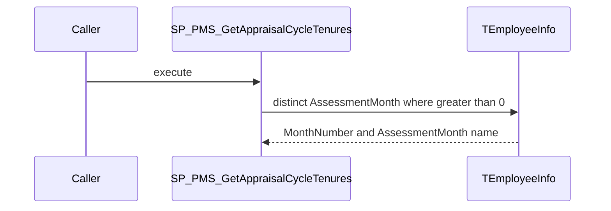
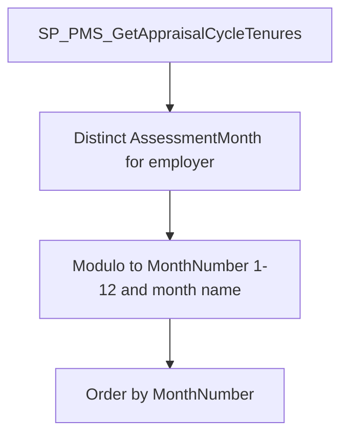

# SP_PMS_GetAppraisalCycleTenures

## What it does

Returns the distinct assessment-tenure months present on active employee-info rows for an employer. Each raw `AssessmentMonth` value is reduced with modulo 12 (remainder 0 becomes 12) to a `MonthNumber` 1–12 and a calendar month name via `CHOOSE`. Ordered by `MonthNumber`. Read-only; calls no nested procedures or functions.

## Parameters

| Name | Direction | What it is for |
|---|---|---|
| `@EmployerId` | in | Employer whose `TEmployeeInfo.AssessmentMonth` values are listed (default `10` in the script) |

## Call sequence

## Callers

No other procedure or function calls this object. `performanceAssessmentDAL.FetchAppraisalAssessmentTenures` executes it for Appraisal Due (and the legacy WebForms tenure combo).

## Nested

Calls no other procedures or functions.

## Steps

1. In `HRMS-DATABASE/HRMS/STOREPROCEDURE/SP_PMS_GetAppraisalCycleTenures.sql`, select distinct `AssessmentMonth` from `TEmployeeInfo` where `ISNULL(AssessmentMonth, 0) > 0` and `employerid = @EmployerId`.
2. Compute `MonthNumber` as `AssessmentMonth % 12`, replacing remainder `0` with `12`.
3. Map `MonthNumber` to January–December with `CHOOSE`.
4. Order by `MonthNumber` and return `MonthNumber`, `AssessmentMonth` (name).

## Tables

| Table | Read or write |
|---|---|
| `dbo.TEmployeeInfo` | read |

## Unresolved calls

None.

## Flow

