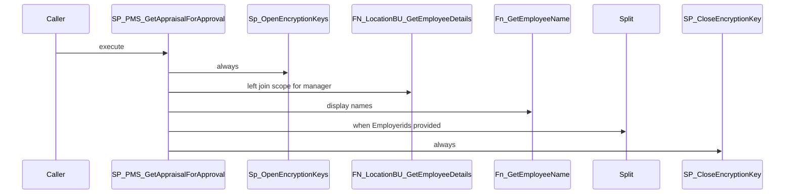
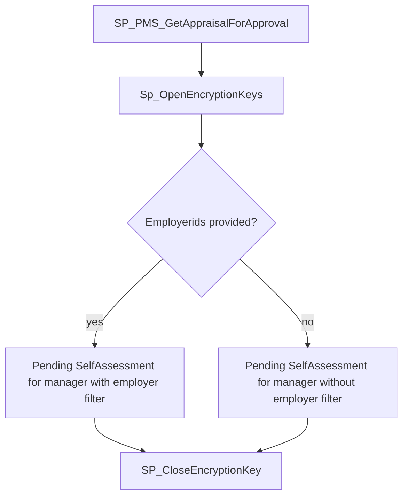

# SP_PMS_GetAppraisalForApproval

## What it does

Lists pending team appraisal assessments for one manager. Returns active employees whose `TPMSEmployeeSelfAppraisal` is `Pending` or `Submitted` on an `Initiated` cycle/frequency, with a pending `TRequestWorkflows` row (`RequestType = 'SelfAssessment'`, `ApproveStatus = 'P'`) where `ManagerId = @ManagerId`. Optional `@Employerids` filters by employer via `dbo.Split`. Used by Performance Assessment Notifications panel **PTeam**.

## Parameters

| Name | Direction | What it is for |
|---|---|---|
| `@ManagerId` | in | Manager whose pending SelfAssessment workflow rows to list |
| `@Employerids` | in | Optional comma-separated employer ids; when empty, no employer filter |

## Call sequence

## Callers

No other procedure or function calls this object. Application callers include Core API `performanceAssessmentDAL.FetchPendingApprisalAssessment` (Performance Assessment Notifications PTeam).

## Nested

| Object | Kind | When | Page |
|---|---|---|---|
| `Sp_OpenEncryptionKeys` | procedure | always | [Sp_OpenEncryptionKeys](/docs/database/hrms/Sp_OpenEncryptionKeys) |
| `SP_CloseEncryptionKey` | procedure | always | [SP_CloseEncryptionKey](/docs/database/hrms/SP_CloseEncryptionKey) |
| `FN_LocationBU_GetEmployeeDetails` | function | left join for `@ManagerId` | [FN_LocationBU_GetEmployeeDetails](/docs/database/hrms/FN_LocationBU_GetEmployeeDetails) |
| `Fn_GetEmployeeName` | function | employee / manager display names | [Fn_GetEmployeeName](/docs/database/hrms/Fn_GetEmployeeName) |
| `Split` | function | when `@Employerids` has length | [Split](/docs/database/hrms/Split) |

## Steps

Script: `HRMS-DATABASE/HRMS/STOREPROCEDURE/SP_PMS_GetAppraisalForApproval.sql`.

1. Open encryption keys.
2. If `@Employerids` has length, select distinct pending team appraisal rows filtered by employer split (two union branches), left-joining location/BU scope for the manager; order by cycle, frequency, employee.
3. Else select the same without employer filter.
4. Close encryption keys.

## Tables

| Table | Read or write |
|---|---|
| `TPMSAppraisalCycles` | read |
| `TPMSEmployerConfiguration` | read |
| `TPMSEmployeeSelfAppraisal` | read |
| `TPMSEmployeeAppraisalCycleMapping` | read |
| `TPMS_AppraisalReviewFrequency` | read |
| `TPMS_AppraisalReviewSequence` | read |
| `TRequestWorkflows` | read |
| `TEmployee` / `TEmployeeInfo` | read |
| `TTitle` | read |
| `TPMS_EmployeeAutoCloseRequest` | read |

## Unresolved calls

None.

## Flow

