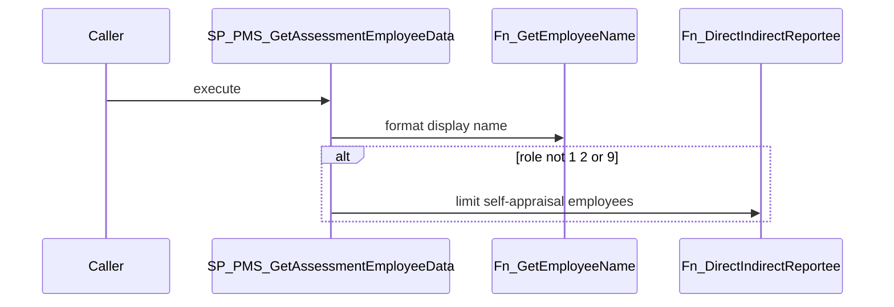
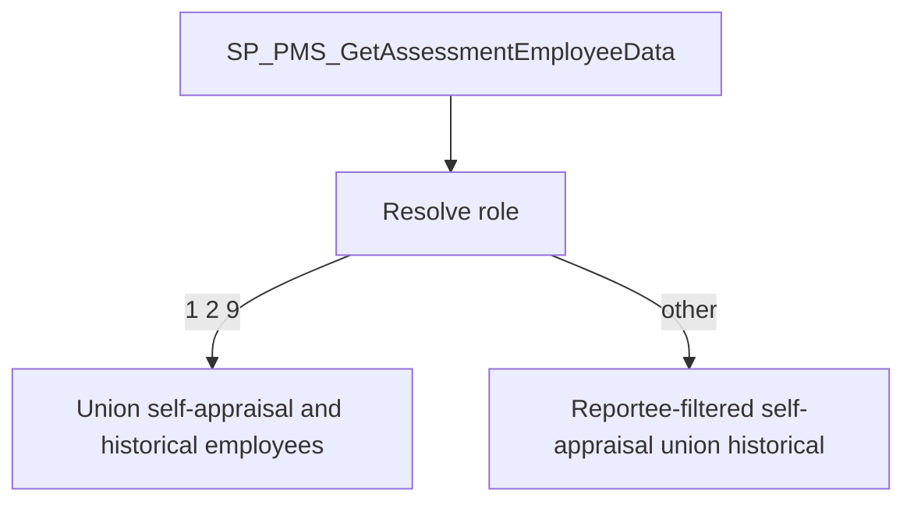

# SP_PMS_GetAssessmentEmployeeData

## What it does

Returns the employee picker list for the PMS Dashboard growth chart. Combines employees who have a self-appraisal row with employees who have historical growth data. Admin/HR roles (1, 2, 9) see the whole employer; other roles restrict self-appraisal rows to reportees.

## Parameters

| Name | Direction | What it is for |
|---|---|---|
| `@Employerid` | in | Employer of `TEmployeeInfo` rows |
| `@Employeeid` | in | Viewer used for role and reportee scope |

## Call sequence

## Callers

No other procedure or function calls this object. App caller: `performanceAssessmentDAL.GetAssessmentEmployeeData` (executes `sp_PMS_GetAssessmentEmployeeData`).

## Nested

| Object | Kind | When | Page |
|---|---|---|---|
| `Fn_GetEmployeeName` | function | every result row | [Fn_GetEmployeeName](/docs/database/hrms/Fn_GetEmployeeName) |
| `Fn_DirectIndirectReportee` | function | non-admin / non-HR branch on self-appraisal union | [Fn_DirectIndirectReportee](/docs/database/hrms/Fn_DirectIndirectReportee) |

## Steps

In `HRMS-DATABASE/HRMS/STOREPROCEDURE/SP_PMS_GetAssessmentEmployeeData.sql`:

1. Resolve role for `@Employeeid`.
2. For roles 1, 2, 9, union employees from `TPMSEmployeeSelfAppraisal` and `TPMS_HistoricalEmployeeGrowthData` for the employer, formatting names with `Fn_GetEmployeeName`.
3. For other roles, apply `Fn_DirectIndirectReportee` to the self-appraisal half of the union (historical half is not re-filtered in the script).
4. Order by employee name.

## Tables

| Table | Read or write |
|---|---|
| `dbo.TUsers` | read |
| `dbo.TRoles` | read |
| `dbo.TUserEmployee` | read |
| `dbo.TEmployee` | read |
| `dbo.TPMSEmployeeSelfAppraisal` | read |
| `dbo.TEmployeeInfo` | read |
| `dbo.TPMS_HistoricalEmployeeGrowthData` | read |

## Flow

