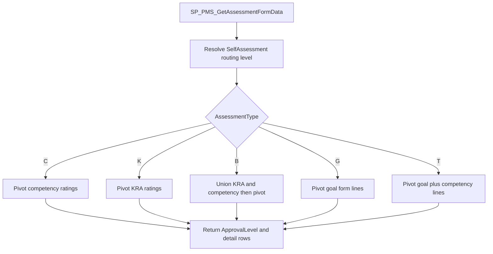

# SP_PMS_GetAssessmentFormData

## What it does

Builds the expanded Assessment Report detail for one appraisal form (`@Appraisalformid`) and process type (`@AssessmentType`). Rating rows from `TPMSEmployeeCompetencyRatings` are pivoted so each competency/KRA/goal line carries Emp and L1–L4 comments, rating descriptions, and calculated weightages. Branches cover Competency (`C`), KRA (`K`), KRA & Competency (`B`), Goal (`G`), and Goal & Competency (`T`). Also returns workflow routing level as `ApprovalLevel`.

## Parameters

| Name | Direction | What it is for |
|---|---|---|
| `@Appraisalformid` | in | `TPMSEmployeeSelfAppraisal.TransId` |
| `@AssessmentType` | in | Process type char (default `'C'`) |

## Call sequence

Calls no other procedures or functions.

## Callers

No other procedure or function calls this object.

## Nested

Calls no other procedures or functions.

## Steps

1. Resolve `@lv_workFlowRoutingLevel` from `TWorkflowManagement` / `TRequestWorkflows` for request type `SelfAssessment` on the form id (default 1).

2. **`C`**: load competency rating rows for the form and cycle process type into a temp table; cursor-pivot Emp/L1–L4 fields; return with `ApprovalLevel`.

3. **`K`**: same pivot for KRA-oriented columns (KPA, assigned/achieved targets, optional cumulative targets when employer flags allow).

4. **`B`**: union KRA-style and competency-style rating lines for the same form, then pivot like `K`.

5. **`G`**: join goal form data details and goal sections; pivot optional fields and headers from goal-setting details.

6. **`T`**: goal lines with `FormDataId` plus competency lines without form-data id; pivot like `G`.

## Tables

| Table | Read or write |
|---|---|
| `TWorkflowManagement` | read |
| `TRequestWorkflows` | read |
| `TPMSAppraisalCycles` | read |
| `TPMSEmployeeAppraisalCycleMapping` | read |
| `TPMSEmployeeSelfAppraisal` | read |
| `TPMS_AppraisalReviewFrequency` | read |
| `TPMSEmployeeCompetencyRatings` | read |
| `TPMSEmployerConfiguration` | read |
| `TPMSCategorySections` | read |
| `TPMSCategoryMaster` | read |
| `TPMSCategoryCompetencies` | read |
| `TPMSDesignationMappingForDesignation` | read |
| `TPMSCompetencyMaster` | read |
| `TPMSGoalCategoryDetails` | read |
| `TPMSGoalCategory` | read |
| `TPMSRatingScaleDetails` | read |
| `TEmployeeInfo` | read |
| `TEmployee` | read |
| `TPMSEmployeeGoalFormData` | read |
| `TPMSEmployeeGoalFormDataDetails` | read |
| `TPMS_TEmployeeGoalSections` | read |
| `TPMSEmployeeGoalSettingDetails` | read |

## Flow

