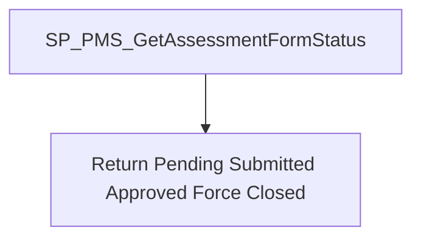

# SP_PMS_GetAssessmentFormStatus

## What it does

Returns a fixed four-row lookup of assessment form statuses used by PMS Dashboard form-status filters: Pending, Submitted, Approved, and Force Closed.

## Parameters

None.

## Call sequence

Calls no other procedures or functions.

## Callers

No other procedure or function calls this object. App caller: `performanceAssessmentDAL.GetAssessmentFormStatus` from PMS Dashboard.

## Nested

Calls no other procedures or functions.

## Steps

In `HRMS-DATABASE/HRMS/STOREPROCEDURE/SP_PMS_GetAssessmentFormStatus.sql`:

1. Select a union of four literal rows with `FormStatus`, `FormID`, and sort `id` 1-4.
2. Order by `id`.

## Tables

None. The result is literal unions only.

## Flow

