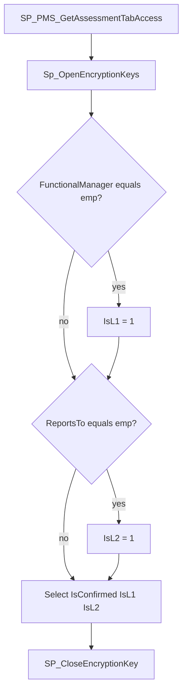

# SP_PMS_GetAssessmentTabAccess

## What it does

For one employee, opens encryption keys, sets `@IsL1` when anyone lists them as `FunctionalManager` on `TEmployeeInfo`, sets `@IsL2` when anyone lists them as `ReportsTo` on `TOrgChart`, then returns the employee’s employment-type `IsConfirmed` flag together with those L1/L2 bits. Used by Employee Confirmation Assessment to decide whether the Team Assessment tab is available.

## Parameters

| Name | Direction | What it is for |
|---|---|---|
| `@empID` | in | Logged-in employee id |

## Call sequence

1. `EXEC Sp_OpenEncryptionKeys`
2. Set `@IsL1` / `@IsL2` from manager existence checks
3. Select `IsConfirmed`, `@IsL1`, `@IsL2` for the employee’s employment type
4. `EXEC SP_CloseEncryptionKey`

## Callers

No other procedure or function calls this object. Application callers include Core API `performanceAssessmentDAL.GetPerformanceAssessmentTabAccess`.

## Nested

| Object | Kind | Page |
|---|---|---|
| `Sp_OpenEncryptionKeys` | procedure | `/docs/database/hrms/Sp_OpenEncryptionKeys` |
| `SP_CloseEncryptionKey` | procedure | `/docs/database/hrms/SP_CloseEncryptionKey` |

## Steps

Script: `HRMS-DATABASE/HRMS/STOREPROCEDURE/SP_PMS_GetAssessmentTabAccess.sql`.

1. Open encryption keys.
2. If any `TEmployeeInfo.FunctionalManager = @empID`, set `@IsL1 = 1`.
3. If any `TOrgChart.ReportsTo = @empID`, set `@IsL2 = 1`.
4. Join `TMEmploymentTypes` to `TEmployeeInfo` for `@empID` and return `IsConfirmed`, `IsL1`, `IsL2`.
5. Close encryption keys.

## Tables

| Table | Read or write |
|---|---|
| `TEmployeeInfo` | read |
| `TOrgChart` | read |
| `TMEmploymentTypes` | read |

## Unresolved calls

None.

## Flow

