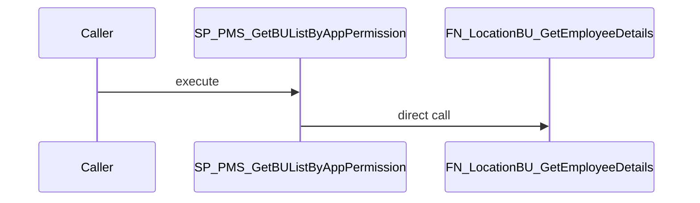
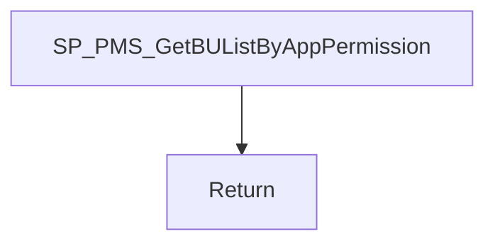

# SP_PMS_GetBUListByAppPermission

## What it does

Stored procedure `SP_PMS_GetBUListByAppPermission`. Reads `TPMSAppraisalCycles`, `TPMSEmployeeAppraisalCycleMapping`, `TPMSEmployeeSelfAppraisal`, `TPMS_AppraisalReviewFrequency`, `TEmployeeinfo`, `TOrgHierarchyDetails`, `TPMSEmployeeGoalSetting`, `TPMSEmployeeGoalMapping`. Calls `FN_LocationBU_GetEmployeeDetails`.

## Parameters

| Name | Direction | What it is for |
|---|---|---|
| `@Employerid` | in | Int |
| `@AppraisalCycleId` | in | int, default 0 |
| `@Employeeid` | in | Int, default 0 |

## Call sequence

## Callers

No other procedure or function calls this object.

## Nested

| Object | Kind | When | Page |
|---|---|---|---|
| `FN_LocationBU_GetEmployeeDetails` | function | direct call | [FN_LocationBU_GetEmployeeDetails](/docs/database/hrms/FN_LocationBU_GetEmployeeDetails) |

## Steps

1. Script is `HRMS-DATABASE/HRMS/STOREPROCEDURE/SP_PMS_GetBUListByAppPermission.sql`.

## Tables

| Table | Read or write |
|---|---|
| `TEmployeeinfo` | read |
| `TOrgHierarchyDetails` | read |
| `TPMSAppraisalCycles` | read |
| `TPMSEmployeeAppraisalCycleMapping` | read |
| `TPMSEmployeeGoalMapping` | read |
| `TPMSEmployeeGoalSetting` | read |
| `TPMSEmployeeSelfAppraisal` | read |
| `TPMS_AppraisalReviewFrequency` | read |

## Flow

