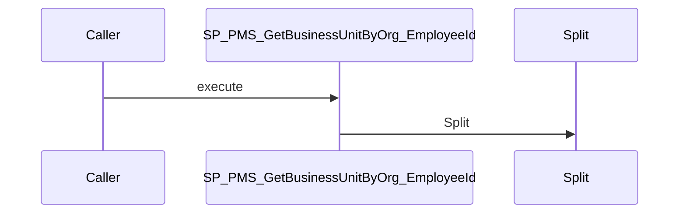
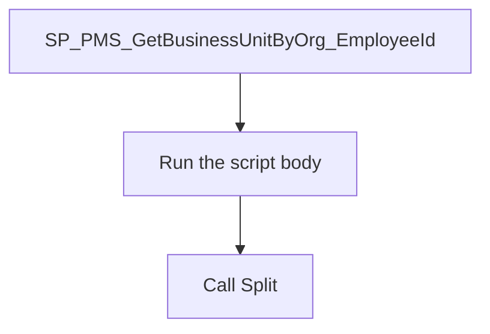

# SP_PMS_GetBusinessUnitByOrg_EmployeeId

## What it does

Lists business units the employee may use, narrowed by role and page-mapping business-unit ids when those exist.

## Parameters

| Name | Direction | What it is for |
|---|---|---|
| `@EmployeeId` | in | Employee Id |
| `@EmployerId` | in | Employer Id. Default null |

## Call sequence

## Callers

No other procedure or function calls this object.

## Nested

| Object | Kind | When | Page |
|---|---|---|---|
| `Split` | function | during execution | [Split](/docs/database/hrms/Split) |

## Steps

Script: `HRMS-DATABASE/HRMS/STOREPROCEDURE/SP_PMS_GetBusinessUnitByOrg_EmployeeId.sql`.

1. select @lv_RoleId = RoleId,@lv_EmployerId = EmployerId
2. SELECT TOP 1 @BusinessUnitIds = BusinessUnitIds
3. SELECT userid
4. SELECT TOP 1 @BusinessUnitIds = CASE WHEN (@BusinessUnitIds IS NULL OR @BusinessUnitIds = '') THEN RM.BusinessUnitIds ELSE @BusinessUnitIds +','+ ISNULL(RM.BusinessUnitIds,'')

## Tables

| Table | Read or write |
|---|---|
| `TUsers` | read |
| `TUserEmployee` | read |
| `TUSerPagesMapping` | read |
| `TRolePagesMapping` | read |
| `TPMSEmployerConfiguration` | read |
| `TOrgHierarchyDetails` | read |

## Flow

