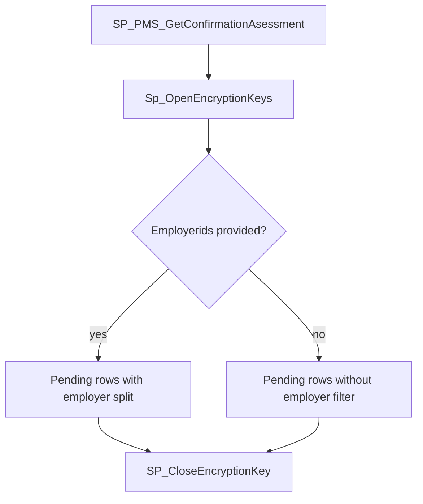

# SP_PMS_GetConfirmationAsessment

## What it does

Lists pending confirmation assessments for one employee when employer config `IsConfSelfAssesmentRequired = 1`, the employee is active, has no `ConfirmationDate`, and `TCMSEmployeeConfirmation.FormStatus = 'Pending'`. Optional `@Employerids` filters by employer via `dbo.Split`. Used by the Self tab Pending Confirmation Assessment grid.

## Parameters

| Name | Direction | What it is for |
|---|---|---|
| `@EmployeeId` | in | Employee whose pending confirmation forms to list |
| `@Employerids` | in | Optional comma-separated employer ids; when empty, no employer filter |

## Call sequence

1. `EXEC Sp_OpenEncryptionKeys`
2. Resolve employer and role name for the employee
3. Select pending confirmation rows (employer-filtered branch or default)
4. `EXEC SP_CloseEncryptionKey`

## Callers

No other procedure or function calls this object. Application callers include Core API `performanceAssessmentDAL.GetPendingConfirmationAssessmentForm`.

## Nested

| Object | Kind | Page |
|---|---|---|
| `Sp_OpenEncryptionKeys` | procedure | `/docs/database/hrms/Sp_OpenEncryptionKeys` |
| `SP_CloseEncryptionKey` | procedure | `/docs/database/hrms/SP_CloseEncryptionKey` |

Also calls function `FN_GetRoleName` (role name is resolved but the HR/Administrator branch that used it is commented out).

## Steps

Script: `HRMS-DATABASE/HRMS/STOREPROCEDURE/SP_PMS_GetConfirmationAsessment.sql`.

1. Open encryption keys; read employer id from `TEmployeeInfo`.
2. Resolve role name via `FN_GetRoleName` / `TUsers` / `TUserEmployee`.
3. If `@Employerids` has length, select pending confirmation rows for `@EmployeeId` with employer split filter and self-assessment required.
4. Else select the same without employer filter.
5. Close encryption keys.

## Tables

| Table | Read or write |
|---|---|
| `TEmployee` / `TEmployeeInfo` | read |
| `TCMSEmployeeConfirmation` | read |
| `TORGChart` | read |
| `TRequestWorkflows` | read (left join pending) |
| `TPMSEmployerConfiguration` | read |
| `TOrgHierarchyDetails` | read (organization unit name) |
| `TUsers` / `TUserEmployee` | read |

## Unresolved calls

None.

## Flow

