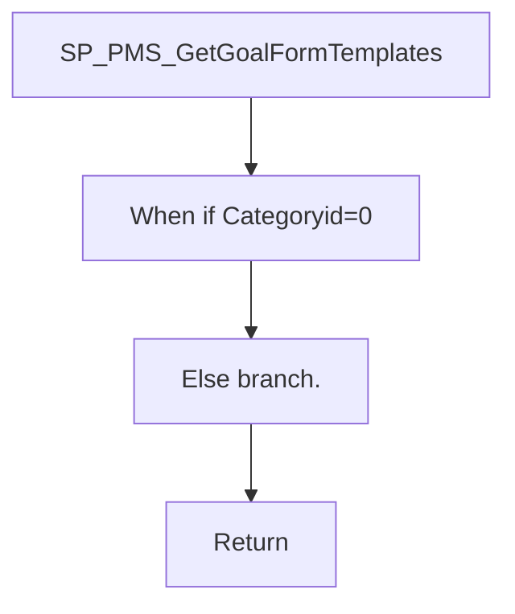

# SP_PMS_GetGoalFormTemplates

## What it does

Stored procedure `SP_PMS_GetGoalFormTemplates`. Reads `tpmscategorymaster`, `tpmsemployeegoalsetting`, `TPMSEmployeeGoalSettingDetails`. Calls no other procedure or function.

## Parameters

| Name | Direction | What it is for |
|---|---|---|
| `@EmployerId` | in | Int |
| `@GoalSettingId` | in | INT |
| `@Categoryid` | in | int, default 0 |

## Call sequence

Calls no other procedures or functions.

## Callers

No other procedure or function calls this object.

## Nested

Calls no other procedures or functions.

## Steps

1. Script is `HRMS-DATABASE/HRMS/STOREPROCEDURE/SP_PMS_GetGoalFormTemplates.sql`.
2. When if(@Categoryid=0)
3. Else branch.

## Tables

| Table | Read or write |
|---|---|
| `TPMSEmployeeGoalSettingDetails` | read |
| `tpmscategorymaster` | read |
| `tpmsemployeegoalsetting` | read |

## Flow

