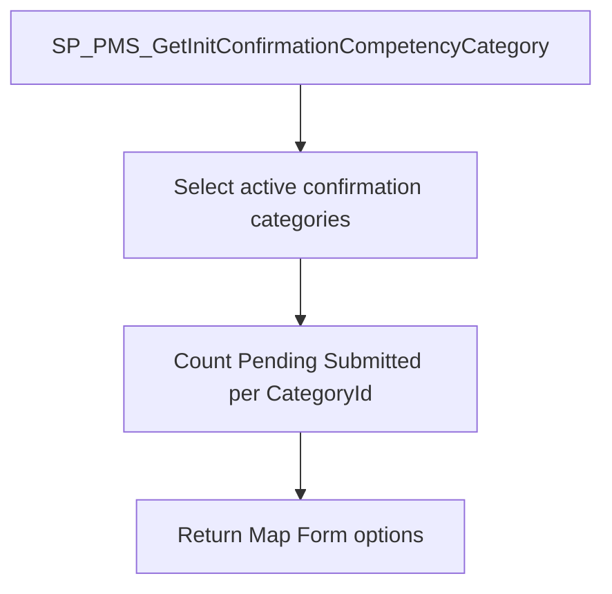

# SP_PMS_GetInitConfirmationCompetencyCategory

## What it does

Lists active, non-deleted confirmation forms (`FormType = 'C'`) for one employer from `tpmscategorymaster`, excluding appraisal types `P` and `T`. Each row includes a count of pending or submitted confirmations that already use that category. Used by Initiate Confirmation’s Map Form dropdown.

## Parameters

| Name | Direction | What it is for |
|---|---|---|
| `@Employerid` | in | Employer whose confirmation categories to list |

## Call sequence

Calls no other procedures or functions.

## Callers

No other procedure or function calls this object. Application callers include Core API `performanceAssessmentDAL.GetInitConfirmationCompetencyCategory`.

## Nested

Calls no other procedures or functions.

## Steps

Script: `HRMS-DATABASE/HRMS/STOREPROCEDURE/SP_PMS_GetInitConfirmationCompetencyCategory.sql`.

1. Select `Categoryid`, `CategoryName`, `FormType`, and `PendingConfCnt` from `tpmscategorymaster` for `@Employerid`.
2. Restrict to `IsDeleted = 0`, `Isactive = 1`, `FormType = 'C'`, and `AppraisalType` not in (`P`, `T`).
3. Order by `Categoryid` descending.

## Tables

| Table | Read or write |
|---|---|
| `tpmscategorymaster` | read |
| `TCMSEmployeeConfirmation` | read (pending/submitted count subquery) |

## Flow

