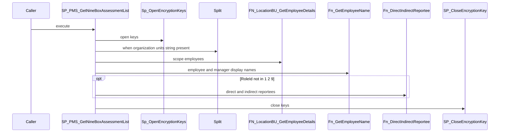
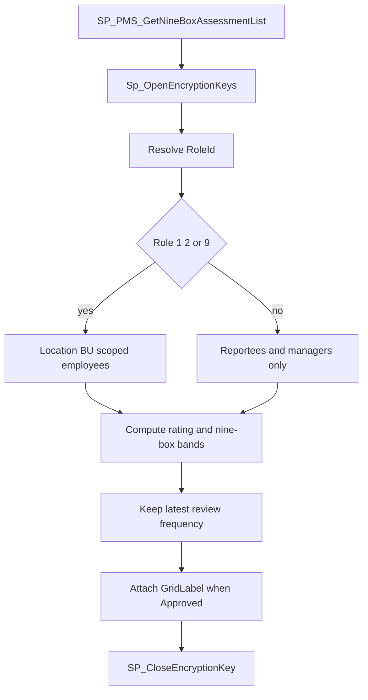

# SP_PMS_GetNineBoxAssessmentList

## What it does

Builds the flat 9-Box employee list for one appraisal cycle. Resolves the caller’s role, scopes employees by location/BU access (and for non-admin roles by functional/reporting/reportee tree), computes final rating and performance/potential bands from cumulative ratings and `TPMS_AppraisalNineBoxGrid`, then returns one row per employee on the latest review frequency with `GridLabel` from `TPMS_NineBoxGridDetails` when the form is Approved.

## Parameters

| Name | Direction | What it is for |
|---|---|---|
| `@EmployerId` | in | Employer scope |
| `@AppraisalCycleId` | in | Assessment cycle |
| `@OrganizationUnits` | in | Optional comma-separated business unit ids; empty becomes null (all units) |
| `@EmployeeId` | in | Logged-in employee used for role and access scope |

## Call sequence

## Callers

No other procedure or function calls this object. Application callers include Core API `GetNineBoxAssessmentList` and legacy `PerformanceAssessmentDAL.GetNineBoxAssessmentList`.

## Nested

| Object | Kind | When | Page |
|---|---|---|---|
| `Sp_OpenEncryptionKeys` | procedure | start of body | [Sp_OpenEncryptionKeys](/docs/database/hrms/Sp_OpenEncryptionKeys) |
| `Split` | function | parse `@OrganizationUnits` | [Split](/docs/database/hrms/Split) |
| `FN_LocationBU_GetEmployeeDetails` | function | employee access scope join | [FN_LocationBU_GetEmployeeDetails](/docs/database/hrms/FN_LocationBU_GetEmployeeDetails) |
| `Fn_GetEmployeeName` | function | employee and manager names | [Fn_GetEmployeeName](/docs/database/hrms/Fn_GetEmployeeName) |
| `Fn_DirectIndirectReportee` | function | non-admin role branch | [Fn_DirectIndirectReportee](/docs/database/hrms/Fn_DirectIndirectReportee) |
| `SP_CloseEncryptionKey` | procedure | end of body (`SP_CloseEncryptiOnKey` in script) | [SP_CloseEncryptionKey](/docs/database/hrms/SP_CloseEncryptionKey) |

## Steps

Script: `HRMS-DATABASE/HRMS/STOREPROCEDURE/SP_PMS_GetNineBoxAssessmentList.sql`.

1. Open encryption keys.
2. Resolve `@RoleID` from `TUsers` / `TRoles` / `TUserEmployee` / `TEmployee` for `@EmployeeId`.
3. Normalize empty `@OrganizationUnits` to null; split remaining ids into a table variable via `Split`.
4. If role is 1, 2, or 9, insert candidate rows for all in-scope employees on the cycle; else restrict to functional manager, org-chart reports-to, or `Fn_DirectIndirectReportee`.
5. For each candidate, derive `FinalRating` from `TPMSAppraisalCumulativeRating` (and related weightage rules), `PerformanceLevel` from `TPMS_AppraisalNineBoxGrid` (Performance) using final or normalised rating, and `PotentialLevel` from Potential ranges or `TPMS_NineBoxPotentialLevels` / questionnaire average.
6. Cursor over the latest review frequency; average multi-frequency ratings into the performance band when required.
7. Select result rows with `GridLabel` from `TPMS_NineBoxGridDetails` when `FormStatus = 'Approved'`.
8. Close encryption keys.

## Tables

| Table | Read or write |
|---|---|
| `TUsers` | read |
| `TRoles` | read |
| `TUserEmployee` | read |
| `TEmployee` | read |
| `TEmployeeInfo` | read |
| `TTitle` | read |
| `TOrgHierarchyDetails` | read |
| `TORGChart` | read |
| `TPMSEmployeeSelfAppraisal` | read |
| `TPMS_AppraisalReviewFrequency` | read |
| `TPMSEmployeeAppraisalCycleMapping` | read |
| `TPMSCategoryMaster` | read |
| `TPMSAppraisalCycles` | read |
| `TPMSAppraisalPermissions` | read |
| `TRequestWorkflows` | read |
| `TPMSEmployerConfiguration` | read |
| `TPMSAppraisalCumulativeRating` | read |
| `TPMSEmployeeAppraisalForBellCurve` | read |
| `TPMS_AppraisalNineBoxGrid` | read |
| `TPMS_NineBoxPotentialLevels` | read |
| `TPMS_NineBoxFinalReviewerQuestionnaire` | read |
| `TPMS_NineBoxGridDetails` | read |
| `tpmsemployeecompetencyratings` | read |

## Flow

