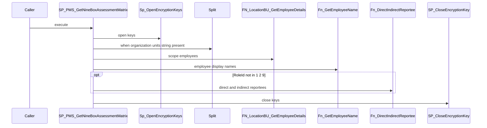
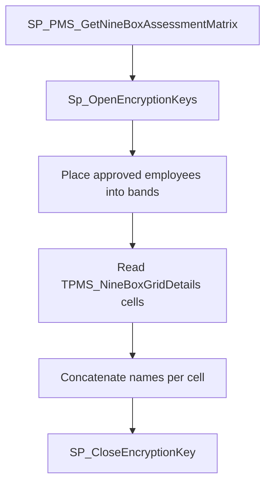

# SP_PMS_GetNineBoxAssessmentMatrix

## What it does

Builds the 9-Box matrix payload for one appraisal cycle. Uses the same role and access scoping as the list procedure to place approved employees into Low/Moderate/High performance × potential bands, then returns every `TPMS_NineBoxGridDetails` cell for the employer with concatenated employee name HTML, a two-name preview, and a flag when more than two names exist in the cell.

## Parameters

| Name | Direction | What it is for |
|---|---|---|
| `@EmployerId` | in | Employer scope |
| `@AppraisalCycleId` | in | Assessment cycle |
| `@OrganizationUnits` | in | Optional comma-separated business unit ids; empty becomes null |
| `@EmployeeId` | in | Logged-in employee used for role and access scope |

## Call sequence

## Callers

No other procedure or function calls this object. Application callers include Core API `GetNineBoxAssessmentMatrix` and legacy `PerformanceAssessmentDAL.GetNineBoxAssessmentMatrix`.

## Nested

| Object | Kind | When | Page |
|---|---|---|---|
| `Sp_OpenEncryptionKeys` | procedure | start of body | [Sp_OpenEncryptionKeys](/docs/database/hrms/Sp_OpenEncryptionKeys) |
| `Split` | function | parse `@OrganizationUnits` | [Split](/docs/database/hrms/Split) |
| `FN_LocationBU_GetEmployeeDetails` | function | employee access scope join | [FN_LocationBU_GetEmployeeDetails](/docs/database/hrms/FN_LocationBU_GetEmployeeDetails) |
| `Fn_GetEmployeeName` | function | employee display names | [Fn_GetEmployeeName](/docs/database/hrms/Fn_GetEmployeeName) |
| `Fn_DirectIndirectReportee` | function | non-admin role branch | [Fn_DirectIndirectReportee](/docs/database/hrms/Fn_DirectIndirectReportee) |
| `SP_CloseEncryptionKey` | procedure | end of body (`SP_CloseEncryptiOnKey` in script) | [SP_CloseEncryptionKey](/docs/database/hrms/SP_CloseEncryptionKey) |

## Steps

Script: `HRMS-DATABASE/HRMS/STOREPROCEDURE/SP_PMS_GetNineBoxAssessmentMatrix.sql`.

1. Open encryption keys.
2. Resolve `@RoleID` for `@EmployeeId`.
3. Normalize and split `@OrganizationUnits`.
4. Insert role-scoped candidate employees with computed `PerformanceLevel`, `PotentialLevel`, and `FinalRating` (same band logic as the list procedure).
5. Cursor over the latest review frequency to finalise performance bands.
6. Select from `TPMS_NineBoxGridDetails` for `@EmployerId`, ordered by `RowId` descending then `ColumnId`, attaching `EmployeeNamesByNineBox`, `SubStringEmployeeNamesByNineBox` (top 2), and `IsMoreNineBoxNamesEnabled`.
7. Close encryption keys.

## Tables

| Table | Read or write |
|---|---|
| `TUsers` | read |
| `TRoles` | read |
| `TUserEmployee` | read |
| `TEmployee` | read |
| `TEmployeeInfo` | read |
| `TTitle` | read |
| `TOrgHierarchyDetails` | read |
| `TORGChart` | read |
| `TPMSEmployeeSelfAppraisal` | read |
| `TPMS_AppraisalReviewFrequency` | read |
| `TPMSEmployeeAppraisalCycleMapping` | read |
| `TPMSCategoryMaster` | read |
| `TPMSAppraisalCycles` | read |
| `TPMSAppraisalPermissions` | read |
| `TRequestWorkflows` | read |
| `TPMSEmployerConfiguration` | read |
| `TPMSAppraisalCumulativeRating` | read |
| `TPMSEmployeeAppraisalForBellCurve` | read |
| `TPMS_AppraisalNineBoxGrid` | read |
| `TPMS_NineBoxPotentialLevels` | read |
| `TPMS_NineBoxFinalReviewerQuestionnaire` | read |
| `TPMS_NineBoxGridDetails` | read |
| `tpmsemployeecompetencyratings` | read |

## Flow

