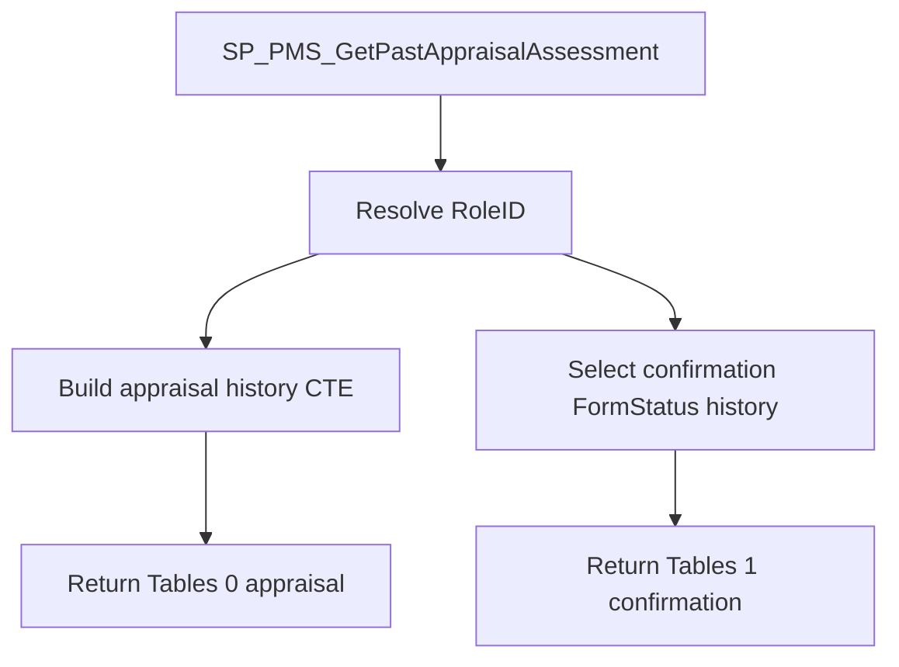

# SP_PMS_GetPastAppraisalAssessment

## What it does

Returns two result sets for one employee. Tables[0] is historical performance appraisal assessments (cycle name, scores, managers, view-HR-comments flag). Tables[1] is submitted/approved/extended/terminated **confirmation** self history from `TCMSEmployeeConfirmation`. Employee Confirmation Assessment’s Submitted Self Assessments grid uses only Tables[1] (Core API `GetSubmittedConfirmationSelfAssessmentHistory`).

## Parameters

| Name | Direction | What it is for |
|---|---|---|
| `@EmployeeId` | in | Employee whose past appraisal and confirmation rows to return |

## Call sequence

1. Resolve the employee’s active `@RoleID` from `TUsers` / `TRoles` / `TUserEmployee`.
2. Build appraisal history CTE (`temp`) from appraisal cycle mappings and related score tables; select Tables[0].
3. Select confirmation history where `FormStatus` is Submitted, Approved, Extended, or Terminate (Tables[1]), applying `TCMSConfirmationViewManagerPermissions` / reportee rules for `ViewHRComments`.

## Callers

No other procedure or function calls this object. Application callers include Core API `performanceAssessmentDAL.GetSubmittedConfirmationSelfAssessmentHistory` (returns `recordsets[1]`) and legacy performance past-assessment binders that consume Tables[0].

## Nested

Calls no other procedures. Uses functions `Fn_GetEmployeeName` and `Fn_DirectIndirectReportee`.

## Steps

Script: `HRMS-DATABASE/HRMS/STOREPROCEDURE/SP_PMS_GetPastAppraisalAssessment.sql`.

1. Look up `@RoleID` for the active employee.
2. CTE over appraisal mappings with cycle/frequency labels, managers, score method min/max, and view permissions.
3. Project Tables[0] final score display columns ordered by review frequency.
4. Project Tables[1] confirmation rows for `@EmployeeId` with functional/reporting managers and `ViewHRComments`.

## Tables

| Table | Read or write |
|---|---|
| `TUsers` / `TRoles` / `TUserEmployee` / `TEmployee` | read |
| `TPMSEmployeeAppraisalCycleMapping` and related appraisal score tables | read (Tables[0]) |
| `TPMSAppraisalCycles` / `TPMS_AppraisalReviewFrequency` | read |
| `TCMSEmployeeConfirmation` | read (Tables[1]) |
| `TEmployeeInfo` / `TORGChart` | read |
| `TRequestWorkflows` | read |
| `TCMSConfirmationViewManagerPermissions` | read |
| `TPMSAssessmentViewManagerPermissions` | read (Tables[0]) |

## Unresolved calls

None.

## Flow

