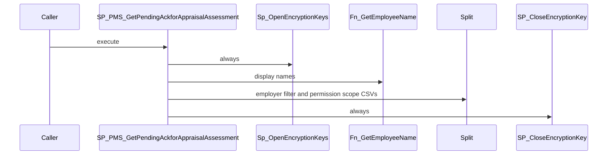
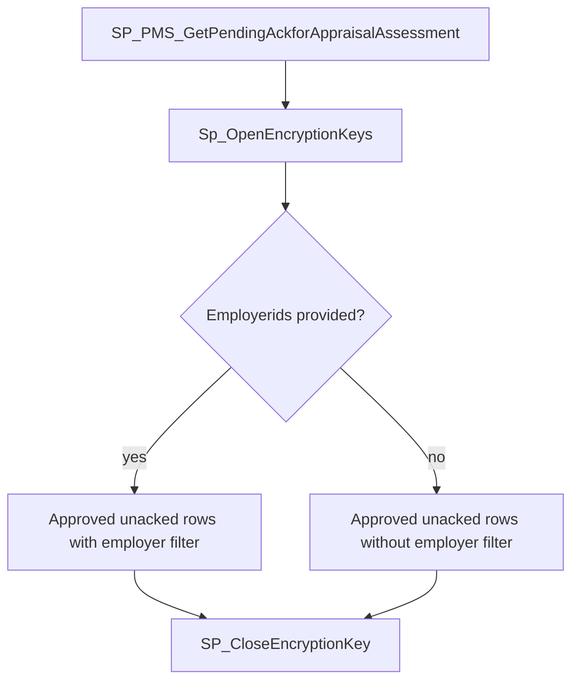

# SP_PMS_GetPendingAckforAppraisalAssessment

## What it does

Lists appraisal forms the employee must acknowledge. Returns active employees' `TPMSEmployeeSelfAppraisal` rows where `FormStatus = 'Approved'`, `IsAcknowledged = 0`, the cycle is `Initiated`, and `TPMSEmployerConfiguration.IsEmpOverallCommentsForAssessment = 1`. Also projects comment/rating visibility permission CSV columns from appraisal permission tables. Optional `@Employerids` filters by employer via `dbo.Split`. Used by Performance Assessment Notifications panel **PAck**.

## Parameters

| Name | Direction | What it is for |
|---|---|---|
| `@EmployeeId` | in | Employee whose pending acknowledgements to list |
| `@Employerids` | in | Optional comma-separated employer ids; when empty, no employer filter |

## Call sequence

## Callers

No other procedure or function calls this object. Application callers include Core API `performanceAssessmentDAL.GetPendingAckforAppraisalAssessment` (Performance Assessment Notifications PAck).

## Nested

| Object | Kind | When | Page |
|---|---|---|---|
| `Sp_OpenEncryptionKeys` | procedure | always | [Sp_OpenEncryptionKeys](/docs/database/hrms/Sp_OpenEncryptionKeys) |
| `SP_CloseEncryptionKey` | procedure | always | [SP_CloseEncryptionKey](/docs/database/hrms/SP_CloseEncryptionKey) |
| `Fn_GetEmployeeName` | function | employee / manager display names | [Fn_GetEmployeeName](/docs/database/hrms/Fn_GetEmployeeName) |
| `Split` | function | employer filter and permission CSV matching | [Split](/docs/database/hrms/Split) |

## Steps

Script: `HRMS-DATABASE/HRMS/STOREPROCEDURE/SP_PMS_GetPendingAckforAppraisalAssessment.sql`.

1. Open encryption keys.
2. If `@Employerids` has length, select approved unacknowledged forms for the employee with employer filter, building `ShowCommentsToEmp` / `ShowRatingsToEmp` from permission tables.
3. Else select the same without employer filter.
4. Close encryption keys.

## Tables

| Table | Read or write |
|---|---|
| `TPMSAppraisalCycles` | read |
| `TPMSEmployeeSelfAppraisal` | read |
| `TPMSEmployeeAppraisalCycleMapping` | read |
| `TPMS_AppraisalReviewFrequency` | read |
| `TPMS_AppraisalReviewSequence` | read |
| `TPMSAppraisalPermissions` | read |
| `TPMSAppraisalViewManagerPermissions` | read |
| `TPMS_ViewEmpManagerRatingPermissions` | read |
| `TPMSEmployerConfiguration` | read |
| `TEmployee` / `TEmployeeInfo` | read |

## Unresolved calls

None.

## Flow

