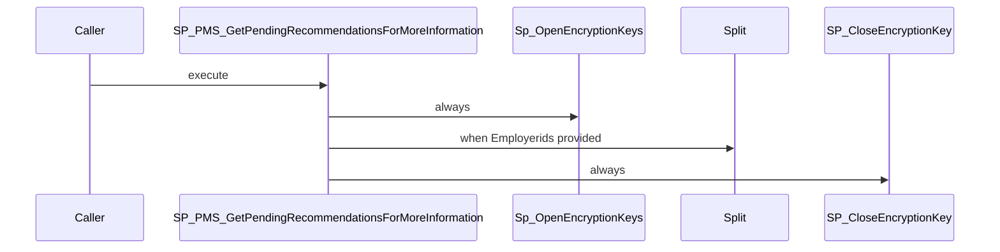
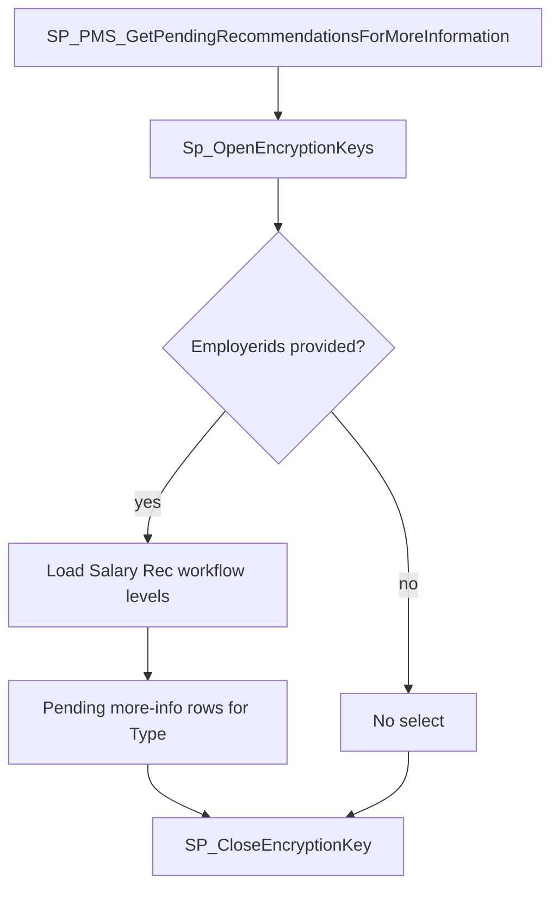

# SP_PMS_GetPendingRecommendationsForMoreInformation

## What it does

Lists unprocessed salary-recommendation RFI rows for one actor. When `@Employerids` is non-empty, takes the first employer id, loads the Salary Recommendations workflow definition from `TWorkflowManagement` to map approval levels to role names, then returns pending `TPMSSalaryRevisionForMoreInfo` / `TPMSViewSalaryRevisionForMoreInfo` rows where the viewer is initiator (`ReviewLevelTo = 0`) or manager, `IsProcessed = 0`, and `Type = @Type` (`Q` question / `A` answer). When `@Employerids` is empty, returns no data after opening/closing encryption keys. Used by Performance Assessment Notifications panels **RFI** (`Q`) and **RFR** (`A`).

## Parameters

| Name | Direction | What it is for |
|---|---|---|
| `@EmployeeId` | in | Actor matched to initiator or manager on the RFI row |
| `@Employerids` | in | Comma-separated employers; first id scopes the result; empty skips the select |
| `@Type` | in | `Q` (request for information) or `A` (response); default `Q` |

## Call sequence

## Callers

No other procedure or function calls this object. Application callers include Core API `performanceAssessmentDAL.GetPendingRecommendationsForMoreInformation` (Performance Assessment Notifications RFI/RFR).

## Nested

| Object | Kind | When | Page |
|---|---|---|---|
| `Sp_OpenEncryptionKeys` | procedure | always | [Sp_OpenEncryptionKeys](/docs/database/hrms/Sp_OpenEncryptionKeys) |
| `SP_CloseEncryptionKey` | procedure | always | [SP_CloseEncryptionKey](/docs/database/hrms/SP_CloseEncryptionKey) |
| `Split` | function | when `@Employerids` has length | [Split](/docs/database/hrms/Split) |

## Steps

Script: `HRMS-DATABASE/HRMS/STOREPROCEDURE/SP_PMS_GetPendingRecommendationsForMoreInformation.sql`.

1. Open encryption keys.
2. If `@Employerids` has length: take the first employer id; resolve Salary Rec workflow id; parse workflow XML into approval-level role names; select pending more-info rows for `@EmployeeId` and `@Type` on that employer.
3. If `@Employerids` is empty: skip the select.
4. Close encryption keys.

## Tables

| Table | Read or write |
|---|---|
| `TWorkflowManagement` | read |
| `TWorkFlowBusinessUnits` | read |
| `TWorkFlowLocations` | read |
| `TPMSSalaryRevisionForMoreInfo` | read |
| `TPMSViewSalaryRevisionForMoreInfo` | read |
| `TPMSAppraisalCycles` | read |
| `TPMSEmployerConfiguration` | read |
| `TEmployee` / `TEmployeeInfo` | read |

## Unresolved calls

None.

## Flow

