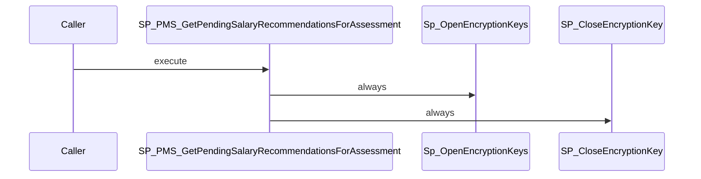
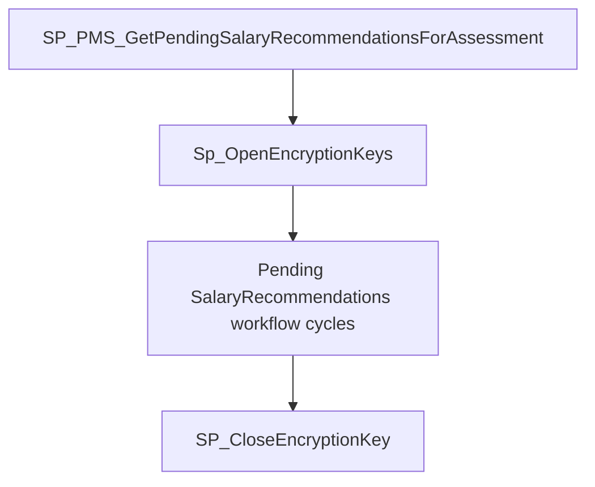

# SP_PMS_GetPendingSalaryRecommendationsForAssessment

## What it does

Lists appraisal cycles with pending salary-recommendation workflow for one employee (as manager). Returns initiated, non-deleted cycles joined to the latest review frequency and a `TRequestWorkflows` row where `RequestType = 'SalaryRecommendations'`, `ApproveStatus = 'P'`, `IsApprove = 0`, and `ManagerId = @EmployeeId`. Projects rating-scale max, process-type label, and distinct mapped employee count from `TPMSSalaryRevForEmployeeAssessment`. Parameter `@EmployerId` is declared but not used in the SELECT filter. Used by Performance Assessment Notifications panel **Salary**.

## Parameters

| Name | Direction | What it is for |
|---|---|---|
| `@EmployeeId` | in | Manager id matched to `TRequestWorkflows.ManagerId` |
| `@EmployerId` | in | Declared for global-access callers; not applied in the script body |

## Call sequence

## Callers

No other procedure or function calls this object. Application callers include Core API `performanceAssessmentDAL.GetPendingSalaryRecommendationsForAssessment` (Performance Assessment Notifications Salary panel).

## Nested

| Object | Kind | When | Page |
|---|---|---|---|
| `Sp_OpenEncryptionKeys` | procedure | always | [Sp_OpenEncryptionKeys](/docs/database/hrms/Sp_OpenEncryptionKeys) |
| `SP_CloseEncryptionKey` | procedure | always (script spells `SP_CloseEncryptiOnKey`) | [SP_CloseEncryptionKey](/docs/database/hrms/SP_CloseEncryptionKey) |

## Steps

Script: `HRMS-DATABASE/HRMS/STOREPROCEDURE/SP_PMS_GetPendingSalaryRecommendationsForAssessment.sql`.

1. Open encryption keys.
2. Select pending salary-recommendation cycles for `@EmployeeId` as workflow manager, using the max review frequency per cycle and counting mapped salary-revision employees.
3. Close encryption keys.

## Tables

| Table | Read or write |
|---|---|
| `TPMSAppraisalCycles` | read |
| `TPMS_AppraisalReviewFrequency` | read |
| `TRequestWorkflows` | read |
| `TPMSRatingScaleDetails` | read |
| `TPMSWeightageScaleDetails` | read |
| `TPMSSalaryRevForEmployeeAssessment` | read |

## Unresolved calls

None.

## Flow

