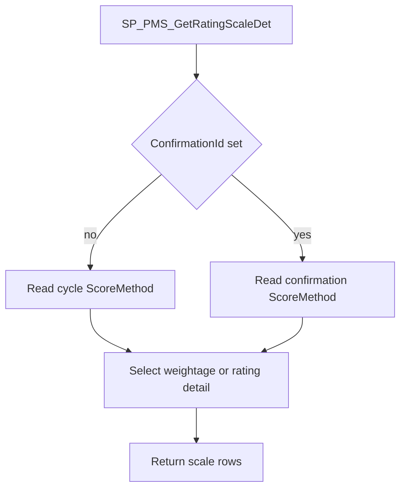

# SP_PMS_GetRatingScaleDet

## What it does

Returns the rating or weightage scale detail rows for an appraisal cycle (when `@ConfirmationId` is 0/null) or for a confirmation form (when `@ConfirmationId` is set). Chooses master/detail tables from the cycle or confirmation `ScoreMethod` (`W`, `R`, `M`, or default rating). Level description text respects employer flags that strip level or definition pieces.

## Parameters

| Name | Direction | What it is for |
|---|---|---|
| `@AppraisalCycleId` | in | Appraisal cycle when loading PMS scale rows |
| `@ConfirmationId` | in | Optional confirmation id; default 0 means use the appraisal cycle path |

## Call sequence

Calls no other procedures or functions.

## Callers

No other procedure or function calls this object. Application callers include Core API `GetAppraisalCycleRating` (used by 9-Box Grid list enrichment and Grid View formatting).

## Nested

Calls no other procedures or functions.

## Steps

Script: `HRMS-DATABASE/HRMS/STOREPROCEDURE/SP_PMS_GetRatingScaleDet.sql`.

1. When `@ConfirmationId` is 0/null, read `ScoreMethod` from `TPMSAppraisalCycles`.
2. If `ScoreMethod = 'W'`, select from `TPMSWeightageScaleDetails` / `TPMSWeightageMaster` via cycle `OutcomeId`.
3. Else if `ScoreMethod = 'R'` or `'M'` (or default), select from `TPMSRatingScaleDetails` / `TPMSRatingMaster` via cycle `RatingId` or `OUTComeid`.
4. When `@ConfirmationId` is set, read `ScoreMethod` from `TCMSEmployeeConfirmation` and return weightage or rating detail for that confirmation’s `RatingScaleid`.
5. Apply `TPMSEmployerConfiguration` flags `IsEnableRemoveRatingLevelFromDefination` / `IsEnableRemoveRatingDefinationFromLevel` when building `LevelDescription`.

## Tables

| Table | Read or write |
|---|---|
| `TPMSAppraisalCycles` | read |
| `TPMSWeightageScaleDetails` | read |
| `TPMSWeightageMaster` | read |
| `TPMSRatingScaleDetails` | read |
| `TPMSRatingMaster` | read |
| `TPMSEmployerConfiguration` | read |
| `TCMSEmployeeConfirmation` | read |

## Flow

