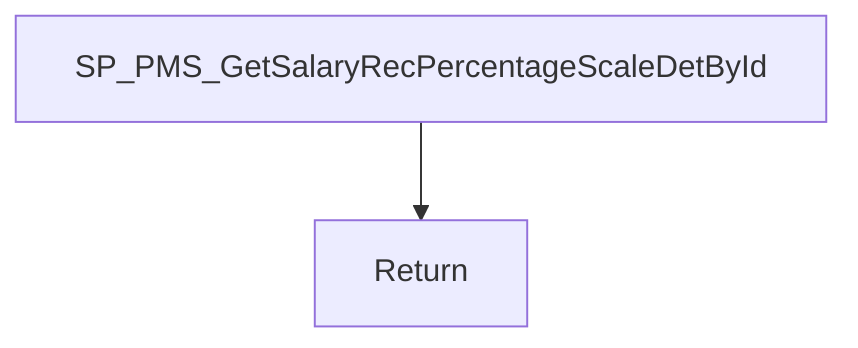

# SP_PMS_GetSalaryRecPercentageScaleDetById

## What it does

Stored procedure `SP_PMS_GetSalaryRecPercentageScaleDetById`. Reads `TPMSSalaryRecPercentageForMapping`, `TPMSSalaryRecPercentageForRatingScaleDetails`. Calls no other procedure or function.

## Parameters

| Name | Direction | What it is for |
|---|---|---|
| `@AppraisalCycleId` | in | INT |
| `@RatingId` | in | Int |
| `@ScoreMethod` | in | varchar(1) |
| `@RecPercentageForMappingid` | in | int |

## Call sequence

Calls no other procedures or functions.

## Callers

No other procedure or function calls this object.

## Nested

Calls no other procedures or functions.

## Steps

1. Script is `HRMS-DATABASE/HRMS/STOREPROCEDURE/SP_PMS_GetSalaryRecPercentageScaleDetById.sql`.

## Tables

| Table | Read or write |
|---|---|
| `TPMSSalaryRecPercentageForMapping` | read |
| `TPMSSalaryRecPercentageForRatingScaleDetails` | read |

## Flow

