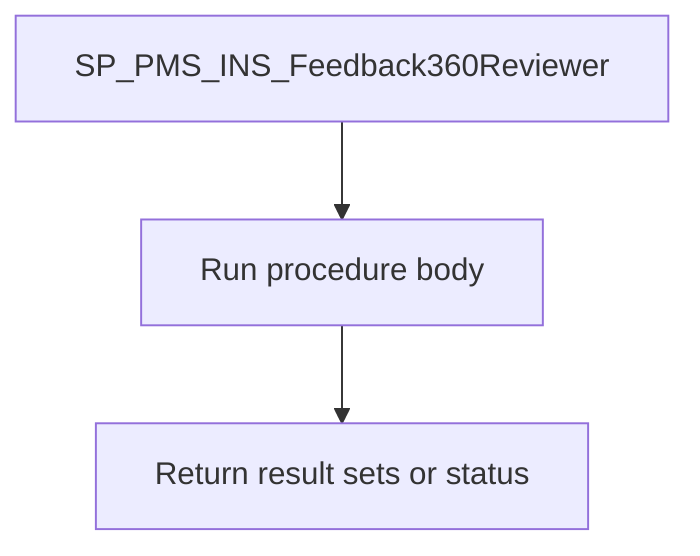

# SP_PMS_INS_Feedback360Reviewer

## What it does

Add one reviewer to one participant, from the Assign Reviewers grid.

## Parameters

| Name | Direction | What it is for |
|---|---|---|
| `@CampaignId` | in | `INT` |
| `@EmployerId` | in | `INT` |
| `@ParticipantId` | in | `INT` |
| `@ReviewerRoleCode` | in | `VARCHAR(20)` |
| `@ReviewerEmployeeId` | in | `INT` |
| `@ExternalName` | in | `NVARCHAR(200)` |
| `@ExternalEmail` | in | `NVARCHAR(256)` |
| `@ManagerTypeCode` | in | `VARCHAR(30)` |
| `@AddedByRoleCode` | in | `VARCHAR(20)` |
| `@CreatedBy` | in | `INT` |

## Call sequence

Calls no other procedures or functions.

## Callers

Application caller: Core API `Feedback360DAL` / `Feedback360Service` for the Performance Assessment → 360° Feedback React module (`Feedback360.aspx`).

| Object | Kind | Page |
|---|---|---|
| _(application)_ | Core API | [360° Feedback guide](/docs/guides/performance-assessment/360-feedback) |

## Nested

Calls no other procedures or functions.

## Steps

1. Sets `XACT_ABORT ON` and `NOCOUNT ON`.
2. Script path: `HRMS-DATABASE/HRMS/STOREPROCEDURE/360Feedback/V1/SP_PMS_INS_Feedback360Reviewer.sql`.

## Tables

| Table | Read or write |
|---|---|
| `dbo.TPMS_Feedback360Campaign` | read |
| `dbo.TPMS_Feedback360Participant` | read |
| `dbo.TPMS_Feedback360Reviewer` | write |

## Flow

