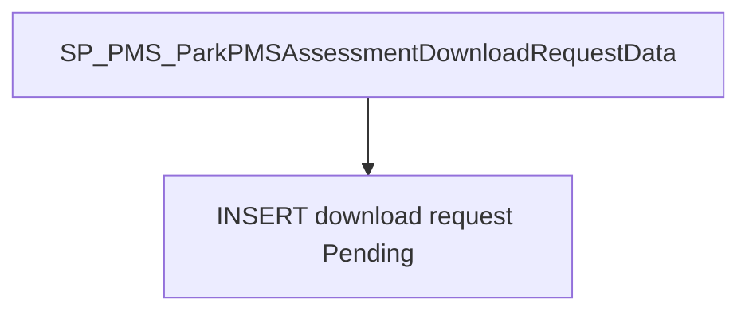

# SP_PMS_ParkPMSAssessmentDownloadRequestData

## What it does

Inserts one Pending Assessment Status PDF-download request for a cycle, employer, requester, assessment type, business-unit filter, and employer logo URL. A scheduler later processes `TPMSAssessmentDownloadRequestData`.

## Parameters

| Name | Direction | What it is for |
|---|---|---|
| `@AppraisalCycleId` | in | Cycle to export |
| `@EmployerId` | in | Employer |
| `@LoginEmployeeId` | in | Requester (`RequestedBy`) |
| `@Status` | in | Initial status (UI sends `Pending`) |
| `@AssessmentType` | in | Process type code (`C`/`G`/…) |
| `@BusinessUnitIds` | in | Comma-separated BU ids |
| `@ImageUrl` | in | Employer logo data URL for PDF header |

## Call sequence

Calls no other procedures or functions.

## Callers

No other procedure or function calls this object.

## Nested

Calls no other procedures or functions.

## Steps

Definition read from DEV `OBJECT_DEFINITION` (no inventoried `.sql` in `HRMS-DATABASE`).

1. `INSERT INTO dbo.TPMSAssessmentDownloadRequestData` with `IsProcessed = 0`, `CreatedDate = GETDATE()`, and the input columns including `BusinessUnitIds` and `ImageUrl`.

## Tables

| Table | Read or write |
|---|---|
| `TPMSAssessmentDownloadRequestData` | write |

## Unresolved calls

None. Source script is missing from the Liquibase inventory (sibling `SP_PMS_ParkPMSAssessmentReportRequestData` is inventoried for Assessment Report, not Status download).

## Flow

