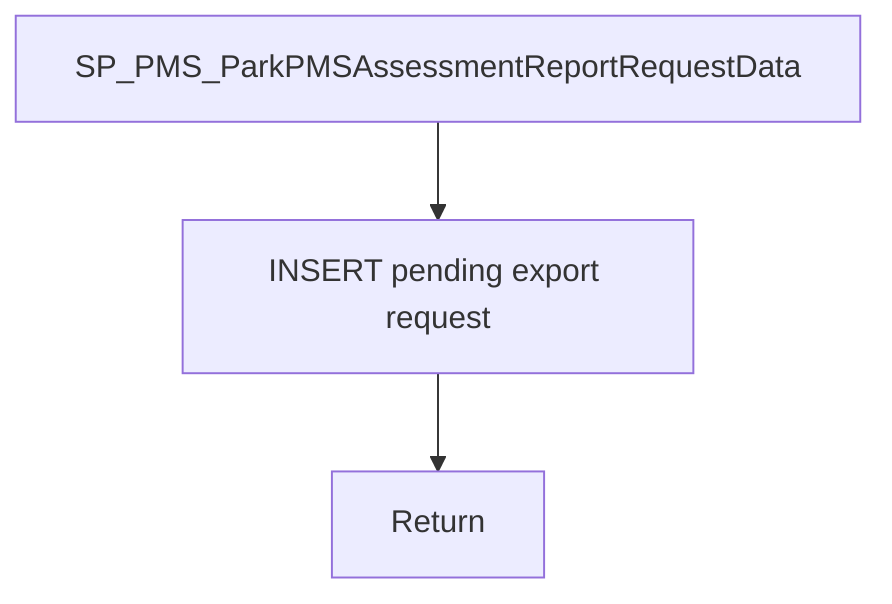

# SP_PMS_ParkPMSAssessmentReportRequestData

## What it does

Inserts one Assessment Report export request row with `IsProcessed = 0`. The SPA posts `Status = 'Pending'` so a scheduler can build the file later.

## Parameters

| Name | Direction | What it is for |
|---|---|---|
| `@AppraisalCycleId` | in | Cycle to export |
| `@EmployerId` | in | Organisation for the request |
| `@LoginEmployeeId` | in | Requested-by employee |
| `@Status` | in | Request status text (SPA sends `Pending`) |
| `@AssessmentType` | in | Process type code (`C`/`K`/`G`/`B`/`T`) |

## Call sequence

Calls no other procedures or functions.

## Callers

No other procedure or function calls this object.

## Nested

Calls no other procedures or functions.

## Steps

1. Insert into `TPMSAssessmentReportRequestData` with `AppraisalCycleId`, `EmployerId`, `RequestedBy`, `CreatedDate = getdate()`, `Status`, `IsProcessed = 0`, and `AssessmentType`.

## Tables

| Table | Read or write |
|---|---|
| `TPMSAssessmentReportRequestData` | write |

## Flow

