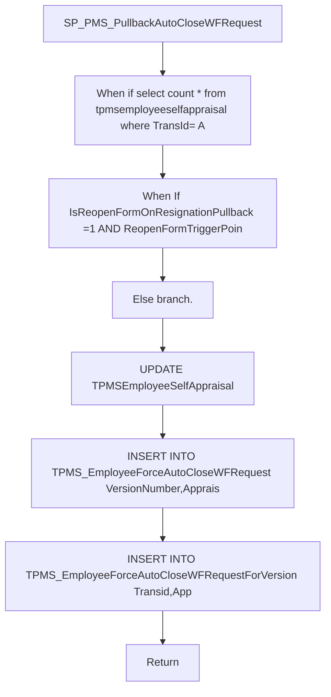

# SP_PMS_PullbackAutoCloseWFRequest

## What it does

Stored procedure `SP_PMS_PullbackAutoCloseWFRequest`. Writes `TPMS_EmployeeForceAutoCloseWFRequest`, `TPMS_EmployeeForceAutoCloseWFRequestForVersion`, `TPMS_AssessmentEmployeeAllUpdates`, `TPMSEmployeeSelfAppraisal`, `TPMSEmployeeCompetencyRatings`, `TrequestWorkFlows`, `TPMSAppraisalCumulativeRating`, `TPMSEmployeeFormComponentComments`, and others. Reads `tpmsemployeeselfappraisal`, `TPMSAppraisalCycles`, `TPMSEmployerConfiguration`, `TPMS_EmployeeTrainingHistory`. Calls no other procedure or function.

## Parameters

| Name | Direction | What it is for |
|---|---|---|
| `@AppraisalCycleId` | in | int |
| `@ReviewFrequencyId` | in | int |
| `@EmployeeId` | in | int |
| `@AppraisalFormid` | in | int |
| `@IsReopenFormOnResignationPullback` | in | bit |
| `@ReopenFormTriggerPoint` | in | varchar(1) |
| `@ReopenFormBehavior` | in | varchar(1) |
| `@ReopenMode` | in | varchar(1) |
| `@ModifiedBy` | in | int |

## Call sequence

Calls no other procedures or functions.

## Callers

| Object | Kind | Page |
|---|---|---|
| `SP_AdminPMS_UpdateForceAutoClosedAppStatus` | procedure | [SP_AdminPMS_UpdateForceAutoClosedAppStatus](/docs/database/hrms/SP_AdminPMS_UpdateForceAutoClosedAppStatus) |

## Nested

Calls no other procedures or functions.

## Steps

1. Script is `HRMS-DATABASE/HRMS/STOREPROCEDURE/SP_PMS_PullbackAutoCloseWFRequest.sql`.
2. When if((select count(*) from tpmsemployeeselfappraisal where TransId=@AppraisalFormid)=0)
3. When If(@IsReopenFormOnResignationPullback =1 AND @ReopenFormTriggerPoint in ('I','A') AND @ReopenFormBehavior ='N' AND @lv_IsSelfassessmentIsRequired=1)
4. Else branch.
5. UPDATE TPMSEmployeeSelfAppraisal
6. INSERT INTO TPMS_EmployeeForceAutoCloseWFRequest(VersionNumber,AppraisalFormId,AppraisalCycleId,ReviewFrequencyId,EmployeeId,EmployerId,CreatedBy,CreatedDate,RejectReason,IsRouteLe
7. INSERT INTO TPMS_EmployeeForceAutoCloseWFRequestForVersion(Transid,AppraisalFormId,CompetencyId,RatingDetaislid,Weightage,attachment,Comments,RatingLevel,
8. When if(@RouteToLevel=0 AND @ReopenFormBehavior ='N')
9. DELETE FROM TPMSEmployeeFormComponentComments WHERE AppraisalFormId = @AppraisalFormid AND AnswerLevel = @RouteToLevel
10. DELETE FROM TRequestWorkflows WHERE RequestTransid = @AppraisalFormid AND RequestType = @RequestType AND ApprovalLevel >= @RouteToLevel
11. DELETE FROM TPMSEmployeeCompetencyRatings WHERE AppraisalFormId = @AppraisalFormid AND RatingLevel > @RouteToLevel
12. update TPMSEmployeeCompetencyRatings
13. DELETE FROM TPMS_EmployeeTrainingDetails WHERE EmployeeTrainingDetailsId IN (
14. DELETE FROM TPMSAppraisalCumulativeRating WHERE ApprovalLevel >= @RouteToLevel
15. DELETE FROM TRequestWorkflows WHERE RequestTransid = @AppraisalFormid AND RequestType = @RequestType AND ApprovalLevel > @RouteToLevel
16. Update TrequestWorkFlows
17. DELETE FROM TPMSEmployeeCompetencyRatings WHERE AppraisalFormId = @AppraisalFormid AND RatingLevel > @RouteToLevel
18. When if(Select count(1) from TRequestWorkflows Where RequestTransid=@AppraisalFormid and RequestType='SelfAssessment' AND ApprovalLevel = (@RouteToLevel)) =0
19. INSERT INTO TPMS_AssessmentEmployeeAllUpdates(TransId,AppraisalFormId,AppraisalCycleId,ReviewFrequencyId, EmployeeId,FormStatus,CreatedBy,CreatedDate)
20. Else branch.
21. INSERT INTO TPMS_AssessmentEmployeeAllUpdates(TransId,AppraisalFormId,AppraisalCycleId,ReviewFrequencyId, EmployeeId,FormStatus,CreatedBy,CreatedDate)
22. DELETE FROM TPMSEmployeeFormComponentComments WHERE AppraisalFormId = @AppraisalFormid AND AnswerLevel > @RouteToLevel
23. DELETE FROM TPMS_EmployeeTrainingDetails WHERE EmployeeTrainingDetailsId IN (
24. DELETE FROM TPMSAppraisalCumulativeRating WHERE ApprovalLevel > @RouteToLevel
25. UPDATE TPMSAppraisalCumulativeRating

## Tables

| Table | Read or write |
|---|---|
| `TPMSAppraisalCumulativeRating` | read and write |
| `TPMSAppraisalCycles` | read |
| `TPMSEmployeeCompetencyRatings` | read and write |
| `TPMSEmployeeFormComponentComments` | read and write |
| `TPMSEmployeeSelfAppraisal` | write |
| `TPMSEmployerConfiguration` | read |
| `TPMS_AssessmentEmployeeAllUpdates` | write |
| `TPMS_EmployeeForceAutoCloseWFRequest` | read and write |
| `TPMS_EmployeeForceAutoCloseWFRequestForVersion` | write |
| `TPMS_EmployeeTrainingDetails` | read and write |
| `TPMS_EmployeeTrainingHistory` | read |
| `TRequestWorkflows` | read and write |
| `TrequestWorkFlows` | write |
| `tpmsemployeeselfappraisal` | read |

## Flow

