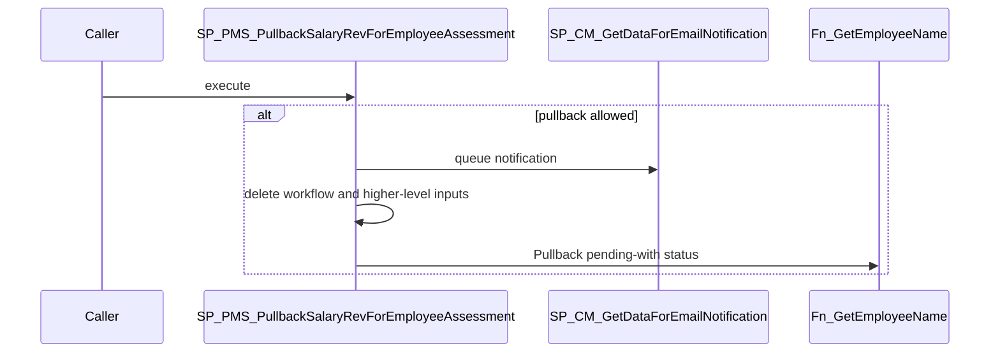
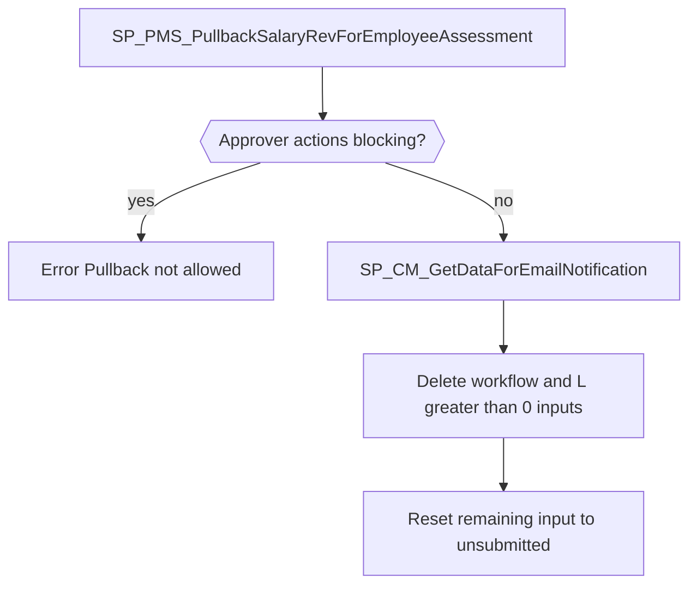

# SP_PMS_PullbackSalaryRevForEmployeeAssessment

## What it does

Pulls back a submitted Salary Recommendations workflow for a cycle when approver actions have not progressed past the allowed point. Reads the current pending `TRequestWorkflows` approval level and whether level-1 hike values already exist. When pullback is allowed: queues email via `SP_CM_GetDataForEmailNotification`, deletes all `SalaryRecommendations` workflow rows and input rows with `ReviewLevel > 0`, then resets the remaining input row to unsubmitted with Status “Pullback now Pending with …”. Otherwise returns an error that approver actions are in process.

## Parameters

| Name | Direction | What it is for |
|---|---|---|
| `@AppraisalCycleID` | in | Cycle / RequestTransid |
| `@ModifiedBy` | in | Actor performing pullback |

## Call sequence

## Callers

No other procedure or function calls this object. `performanceAssessmentDAL.PullbackSalaryRevForEmployeeAssessment` executes it from the Pullback button.

## Nested

| Object | Kind | When | Page |
|---|---|---|---|
| `SP_CM_GetDataForEmailNotification` | procedure | when pullback allowed | [SP_CM_GetDataForEmailNotification](/docs/database/hrms/SP_CM_GetDataForEmailNotification) |
| `Fn_GetEmployeeName` | function | status text | [Fn_GetEmployeeName](/docs/database/hrms/Fn_GetEmployeeName) |

## Steps

1. Script is `HRMS-DATABASE/HRMS/STOREPROCEDURE/SP_PMS_PullbackSalaryRevForEmployeeAssessment.sql`.
2. Read current pending ApprovalLevel and submitted/hike presence on input rows.
3. If blocked, return ErrorCode 1.
4. Else email, delete workflow + `ReviewLevel > 0` inputs, reset remaining row to unsubmitted/redirected.

## Tables

| Table | Read or write |
|---|---|
| `TRequestWorkflows` | read/write (delete) |
| `TPMSSalaryRevInputForEmployeeAssessment` | read/write |
| `TPMSAppraisalCycles` | read |
| `TWorkflowManagement` | read |
| `TEmailNotification` | write |
| `TEmployeeInfo` | read |

## Flow

