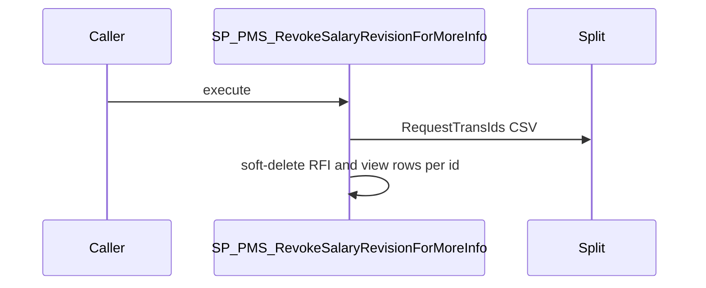
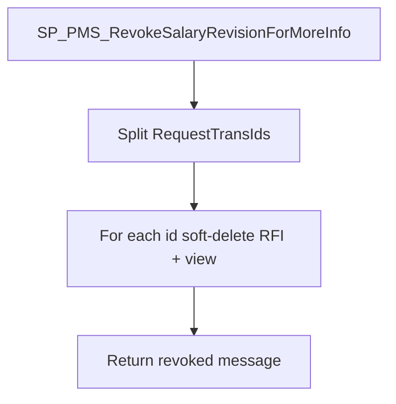

# SP_PMS_RevokeSalaryRevisionForMoreInfo

## What it does

Soft-deletes selected Salary Recommendations RFI questions. Splits `@RequestTransIds` (comma-separated `SalaryRevisionForMoreInfoId` values), then for each id resolves Sequence/EmployeeId and sets `IsDeleted = 1` on matching `TPMSSalaryRevisionForMoreInfo` and `TPMSViewSalaryRevisionForMoreInfo` rows for that sequence.

## Parameters

| Name | Direction | What it is for |
|---|---|---|
| `@RequestTransIds` | in | Comma-separated RFI row ids |
| `@AppraisalCycleId` | in | Cycle id |
| `@ModifiedBy` | in | Actor writing UpdatedBy |

## Call sequence

## Callers

No other procedure or function calls this object. `performanceAssessmentDAL.RevokeSalaryRevisionForMoreInfo` executes it from the Revoke dialog.

## Nested

| Object | Kind | When | Page |
|---|---|---|---|
| `Split` | function | id CSV | [Split](/docs/database/hrms/Split) |

## Steps

1. Script is `HRMS-DATABASE/HRMS/STOREPROCEDURE/SP_PMS_RevokeSalaryRevisionForMoreInfo.sql`.
2. Split ids into a table variable; if empty return error.
3. Cursor each id; soft-delete RFI + view rows for that employee/sequence.
4. Return success message.

## Tables

| Table | Read or write |
|---|---|
| `TPMSSalaryRevisionForMoreInfo` | read/write |
| `TPMSViewSalaryRevisionForMoreInfo` | write |

## Flow

