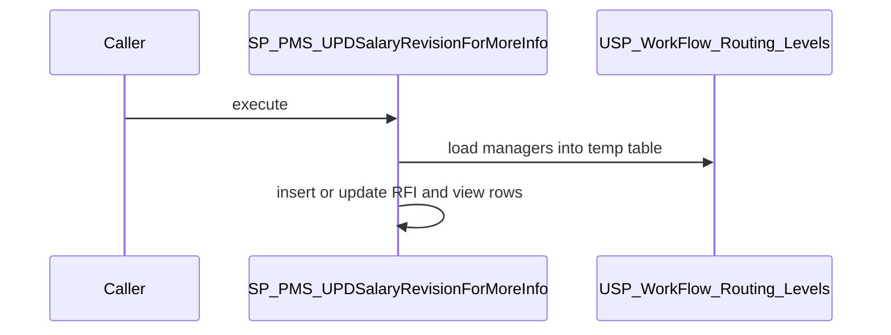
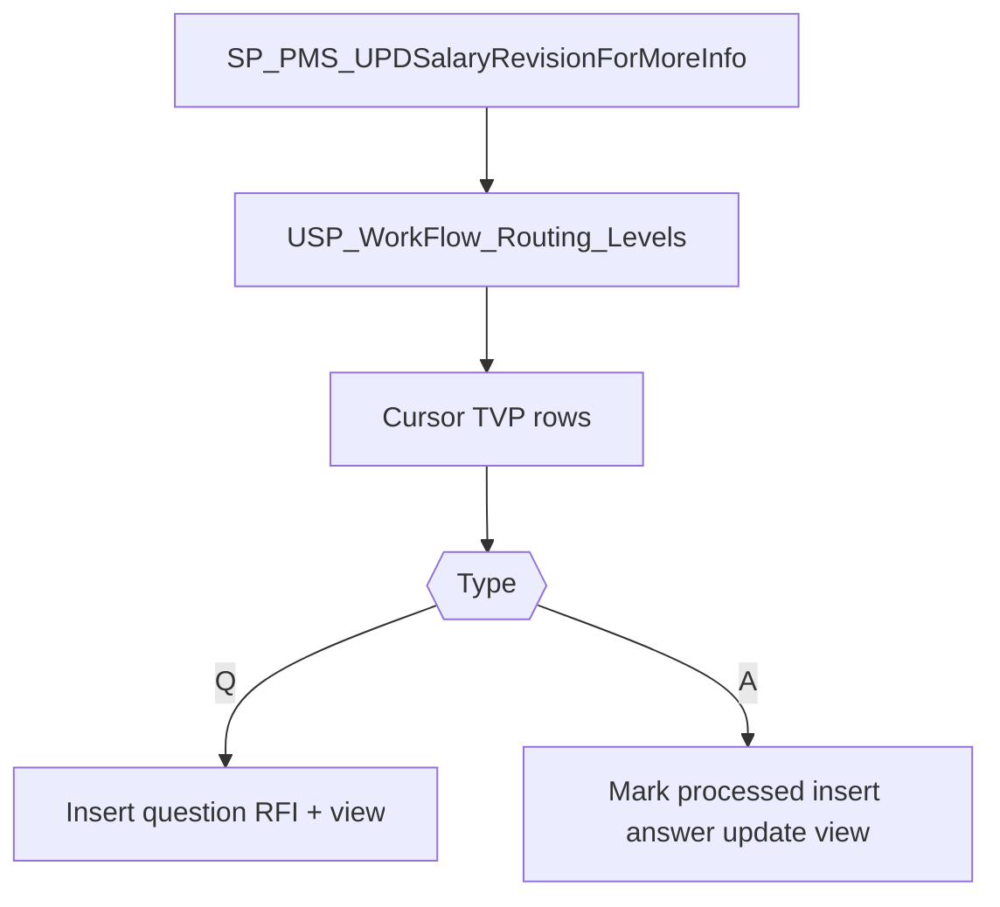

# SP_PMS_UPDSalaryRevisionForMoreInfo

## What it does

Writes Salary Recommendations RFI questions (`Type = 'Q'`) or answers (`Type = 'A'`) from TVP `UDT_SalaryRevisionForMoreInfo`. Resolves workflow managers via `USP_WorkFlow_Routing_Levels`, then cursor-walks each TVP row: for questions, soft-closes prior pending rows for the manager and inserts new pending RFI + view rows; for answers, marks the question processed, routes the answer to the next review level or initiator, and updates `TPMSViewSalaryRevisionForMoreInfo` with the answer text and evidence.

## Parameters

| Name | Direction | What it is for |
|---|---|---|
| `@AppraisalCycleId` | in | Cycle / AssessmentId |
| `@UDTSalaryRevisionForMoreInfo` | in | TVP of RFI rows |
| `@CreatedBy` | in | Asker / answerer |
| `@QuestionId` | in | Sequence when answering; null when asking |

## Call sequence

## Callers

No other procedure or function calls this object. `performanceAssessmentDAL.UPDSalaryRevisionForMoreInfo` executes it from the RFI dialog submit.

## Nested

| Object | Kind | When | Page |
|---|---|---|---|
| `USP_WorkFlow_Routing_Levels` | procedure | start of successful path | [USP_WorkFlow_Routing_Levels](/docs/database/hrms/USP_WorkFlow_Routing_Levels) |

## Steps

1. Script is `HRMS-DATABASE/HRMS/STOREPROCEDURE/SP_PMS_UPDSalaryRevisionForMoreInfo.sql`.
2. Require cycle id and non-empty TVP; resolve workflow; `EXEC USP_WorkFlow_Routing_Levels` into `#Managers`.
3. For each TVP row: Type Q inserts question path; Type A processes answer path and updates the view table.
4. Return ErrorCode 0 with success message, or ErrorCode 1 if no data.

## Tables

| Table | Read or write |
|---|---|
| `TPMSAppraisalCycles` | read |
| `TWorkflowManagement` | read |
| `TPMSSalaryRevForEmployeeAssessment` | read |
| `TPMSSalaryRevInputForEmployeeAssessment` | read |
| `TPMSSalaryRevisionForMoreInfo` | read/write |
| `TPMSViewSalaryRevisionForMoreInfo` | write |

## Flow

