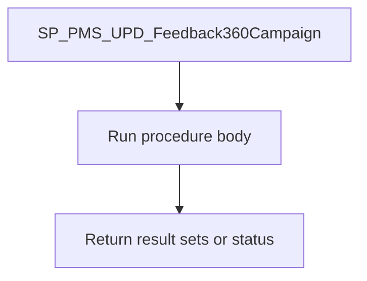

# SP_PMS_UPD_Feedback360Campaign

## What it does

Update a campaign in place — wizard "Save as draft" on an existing

## Parameters

| Name | Direction | What it is for |
|---|---|---|
| `@CampaignId` | in | `INT` |
| `@EmployerId` | in | `INT` |
| `@CampaignName` | in | `NVARCHAR(200)` |
| `@CategoryCode` | in | `VARCHAR(20)` |
| `@CustomCategoryName` | in | `NVARCHAR(100)` |
| `@StartDate` | in | `DATE` |
| `@EndDate` | in | `DATE` |
| `@SelfReviewEnabled` | in | `BIT` |
| `@PeerMinCount` | in | `INT` |
| `@PeerMaxCount` | in | `INT` |
| `@DirectReportCount` | in | `INT` |
| `@ExternalCount` | in | `INT` |
| `@ManagerReviewEnabled` | in | `BIT` |
| `@NominationStartDate` | in | `DATE` |
| `@NominationEndDate` | in | `DATE` |
| `@ReminderFrequencyDays` | in | `TINYINT` |
| `@HRReviewBeforeRelease` | in | `BIT` |
| `@NominationModelCode` | in | `VARCHAR(20)` |
| `@AnonymityThreshold` | in | `INT` |
| `@StrengthThreshold` | in | `DECIMAL(4,2)` |
| `@ShowReportToParticipant` | in | `BIT` |
| `@ShowGroupScores` | in | `BIT` |
| `@ShowWrittenComments` | in | `BIT` |
| `@LastWizardStep` | in | `TINYINT` |
| `@ModifiedBy` | in | `INT` |

## Call sequence

Calls no other procedures or functions.

## Callers

Application caller: Core API `Feedback360DAL` / `Feedback360Service` for the Performance Assessment → 360° Feedback React module (`Feedback360.aspx`).

| Object | Kind | Page |
|---|---|---|
| _(application)_ | Core API | [360° Feedback guide](/docs/guides/performance-assessment/360-feedback) |

## Nested

Calls no other procedures or functions.

## Steps

1. Can raise: Campaign not found for this employer.
2. Can raise: Campaign name cannot be blank.
3. Script path: `HRMS-DATABASE/HRMS/STOREPROCEDURE/360Feedback/V1/SP_PMS_UPD_Feedback360Campaign.sql`.

## Tables

| Table | Read or write |
|---|---|
| `dbo.TPMS_Feedback360Campaign` | write |

## Flow

