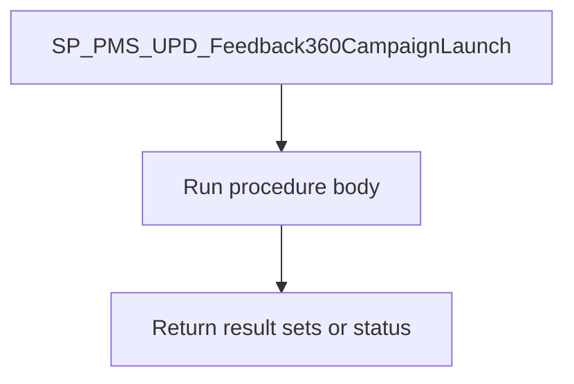

# SP_PMS_UPD_Feedback360CampaignLaunch

## What it does

Launch a Draft campaign: flip it Active and fire the FRD 11.1

## Parameters

| Name | Direction | What it is for |
|---|---|---|
| `@CampaignId` | in | `INT` |
| `@EmployerId` | in | `INT` |
| `@LaunchedBy` | in | `INT` |

## Call sequence

Calls no other procedures or functions.

## Callers

Application caller: Core API `Feedback360DAL` / `Feedback360Service` for the Performance Assessment → 360° Feedback React module (`Feedback360.aspx`).

| Object | Kind | Page |
|---|---|---|
| _(application)_ | Core API | [360° Feedback guide](/docs/guides/performance-assessment/360-feedback) |

## Nested

Calls no other procedures or functions.

## Steps

1. Sets `XACT_ABORT ON` and `NOCOUNT ON`.
2. Runs mutating work inside a transaction.
3. Can raise: Campaign not found for this employer.
4. Can raise: Only a Draft campaign can be launched.
5. Script path: `HRMS-DATABASE/HRMS/STOREPROCEDURE/360Feedback/V1/SP_PMS_UPD_Feedback360CampaignLaunch.sql`.

## Tables

| Table | Read or write |
|---|---|
| `dbo.TPMS_Feedback360Campaign` | write |
| `dbo.TPMS_Feedback360Notification` | write |
| `dbo.TPMS_Feedback360Participant` | read |
| `dbo.TPMS_Feedback360Reviewer` | read |

## Flow

