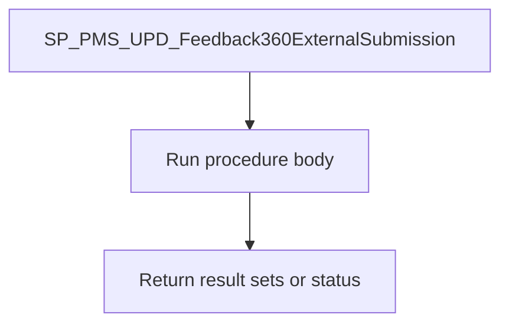

# SP_PMS_UPD_Feedback360ExternalSubmission

## What it does

Save an EXTERNAL reviewer's draft, or take their submission and

## Parameters

| Name | Direction | What it is for |
|---|---|---|
| `@ReviewerId` | in | `INT` |
| `@EmployerId` | in | `INT` |
| `@StatusCode` | in | `VARCHAR(20)` |
| `@AnswersJson` | in | `NVARCHAR(MAX)` |

## Call sequence

Calls no other procedures or functions.

## Callers

Application caller: Core API `Feedback360DAL` / `Feedback360Service` for the Performance Assessment → 360° Feedback React module (`Feedback360.aspx`).

| Object | Kind | Page |
|---|---|---|
| _(application)_ | Core API | [360° Feedback guide](/docs/guides/performance-assessment/360-feedback) |

## Nested

Calls no other procedures or functions.

## Steps

1. Sets `XACT_ABORT ON` and `NOCOUNT ON`.
2. Runs mutating work inside a transaction.
3. Script path: `HRMS-DATABASE/HRMS/STOREPROCEDURE/360Feedback/V1/SP_PMS_UPD_Feedback360ExternalSubmission.sql`.

## Tables

| Table | Read or write |
|---|---|
| `dbo.OPENJSON` | read |
| `dbo.TPMS_Feedback360Campaign` | read |
| `dbo.TPMS_Feedback360ExternalToken` | write |
| `dbo.TPMS_Feedback360Question` | read |
| `dbo.TPMS_Feedback360Reviewer` | read |
| `dbo.TPMS_Feedback360Submission` | write |

## Flow

