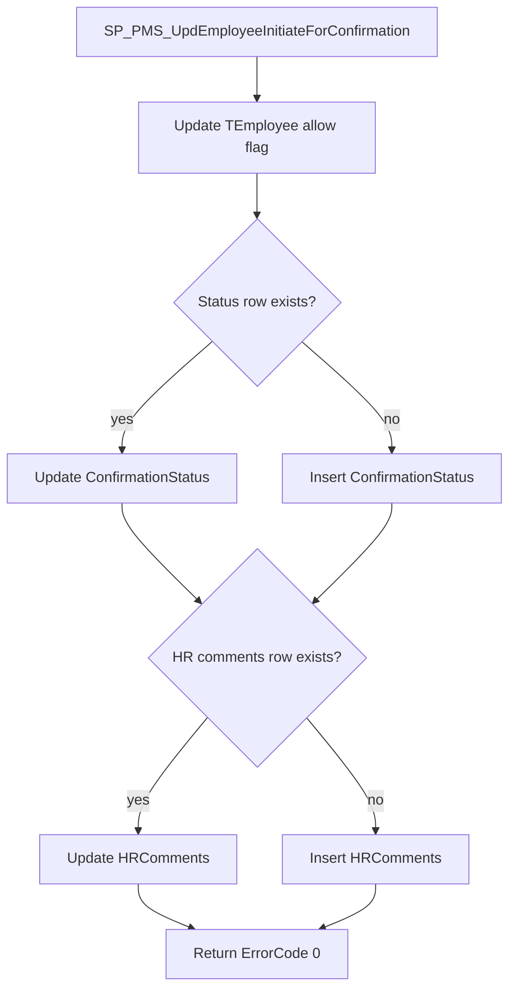

# SP_PMS_UpdEmployeeInitiateForConfirmation

## What it does

Sets `TEmployee.IsAllowedForInitiateConfirmation` for one employee (Stop = `0`, Resume = `1`), upserts `TPMSEmpConfirmationStatus` with Hold / Resigned / Resumed status derived from the bit and HR comments, upserts `TPMSEmpConfirmationHRComments`, and returns `ErrorCode = 0`. Used by Initiate Confirmation Stop / Resume.

## Parameters

| Name | Direction | What it is for |
|---|---|---|
| `@EmployeeId` | in | Employee whose initiate-allow flag is updated |
| `@IsAllowedForInitiateConfirmation` | in | `1` resume / allow; `0` stop / hold (default `0`) |
| `@HRComments` | in | HR comment text; literal `Resigned` drives Resigned status when stopping |
| `@CreatedBy` | in | Creator for new status row insert |

## Call sequence

Calls no other procedures or functions.

## Callers

Procedures and functions that call this object.

| Object | Kind | Page |
|---|---|---|
| `SP_SEP_AddResignationDetails` | procedure | No page yet |

Application callers include Core API `performanceAssessmentDAL.UpdEmployeeInitiateForConfirmation`.

## Nested

Calls no other procedures or functions.

## Steps

Script: `HRMS-DATABASE/HRMS/STOREPROCEDURE/SP_PMS_UpdEmployeeInitiateForConfirmation.sql`.

1. Update `TEmployee.IsAllowedForInitiateConfirmation` for `@EmployeeId`.
2. If a `TPMSEmpConfirmationStatus` row exists, update status (Resumed / Resigned / Hold) and audit columns; else insert a new status row using `@CreatedBy`.
3. If a `TPMSEmpConfirmationHRComments` row exists, update comments; else insert comments (`ConfirmationId = 0`).
4. Select `0` / empty string as `ErrorCode` / `ErrorMsg`.

## Tables

| Table | Read or write |
|---|---|
| `TEmployee` | write |
| `TPMSEmpConfirmationStatus` | read and write |
| `TPMSEmpConfirmationHRComments` | read and write |

## Flow

