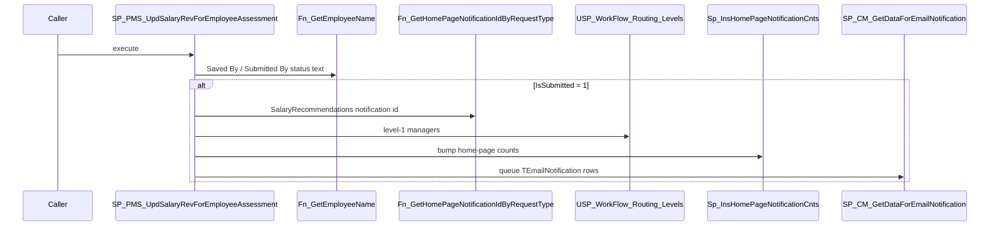
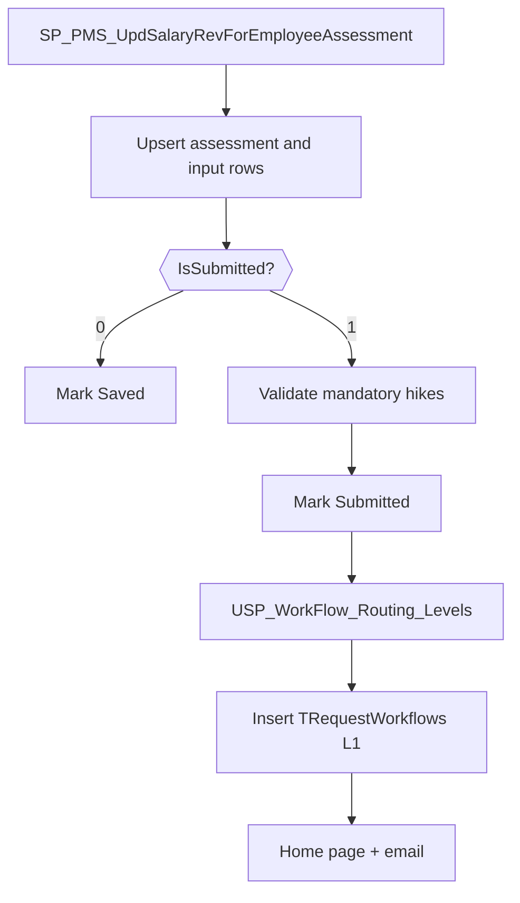

# SP_PMS_UpdSalaryRevForEmployeeAssessment

## What it does

Persists Salary Recommendations from TVP `UDT_SalaryRevForEmployeeAssessment` for one appraisal cycle. Cursor-walks each employee: inserts `TPMSSalaryRevForEmployeeAssessment` when missing, then upserts the active review-level row in `TPMSSalaryRevInputForEmployeeAssessment` (delete+insert when same level already exists). When `@IsSubmitted = 0`, marks rows Saved. When `@IsSubmitted = 1`, validates mandatory encrypted hike fields, marks Submitted, resolves `SalaryRecommendations` workflow managers via `USP_WorkFlow_Routing_Levels`, inserts level-1 `TRequestWorkflows`, bumps home-page notification counts, and queues email via `SP_CM_GetDataForEmailNotification`.

## Parameters

| Name | Direction | What it is for |
|---|---|---|
| `@AppraisalCycleId` | in | Cycle / AssessmentId |
| `@UDTSalaryRevForEmployeeAssessment` | in | TVP of employee hike rows (encrypted CTC/hikes) |
| `@ModifiedBy` | in | Actor employee id |
| `@IsSubmitted` | in | `0` save, `1` submit |

## Call sequence

## Callers

No other procedure or function calls this object. `performanceAssessmentDAL.UpdSalaryRevForEmployeeAssessment` executes it for Save, Submit, pre-Approve save, and Freeze pre-save.

## Nested

| Object | Kind | When | Page |
|---|---|---|---|
| `Fn_GetEmployeeName` | function | status text | [Fn_GetEmployeeName](/docs/database/hrms/Fn_GetEmployeeName) |
| `Fn_GetHomePageNotificationIdByRequestType` | function | submit | [Fn_GetHomePageNotificationIdByRequestType](/docs/database/hrms/Fn_GetHomePageNotificationIdByRequestType) |
| `USP_WorkFlow_Routing_Levels` | procedure | submit | [USP_WorkFlow_Routing_Levels](/docs/database/hrms/USP_WorkFlow_Routing_Levels) |
| `Sp_InsHomePageNotificationCnts` | procedure | submit | [Sp_InsHomePageNotificationCnts](/docs/database/hrms/Sp_InsHomePageNotificationCnts) |
| `SP_CM_GetDataForEmailNotification` | procedure | submit | [SP_CM_GetDataForEmailNotification](/docs/database/hrms/SP_CM_GetDataForEmailNotification) |

## Steps

1. Script is `HRMS-DATABASE/HRMS/STOREPROCEDURE/SP_PMS_UpdSalaryRevForEmployeeAssessment.sql`.
2. Require `@AppraisalCycleId > 0` and non-empty TVP; else error.
3. Cursor each TVP row; insert assessment snapshot if needed; replace or insert input row for the active review level.
4. If save: set `IsSaved` / Status and return success.
5. If submit: reject empty hike ciphertext placeholders; set Submitted; insert L1 `TRequestWorkflows`; notify; email; return success.

## Tables

| Table | Read or write |
|---|---|
| `TPMSSalaryRevForEmployeeAssessment` | read/write |
| `TPMSSalaryRevInputForEmployeeAssessment` | read/write |
| `TPMSAppraisalCycles` | read |
| `TWorkflowManagement` | read |
| `TRequestWorkflows` | write |
| `TWorkflowDetails` | read |
| `TEmailNotification` | write |
| `TEmployeeInfo` | read |

## Flow

