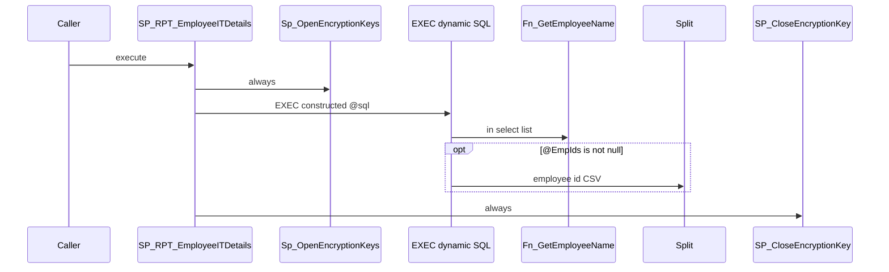
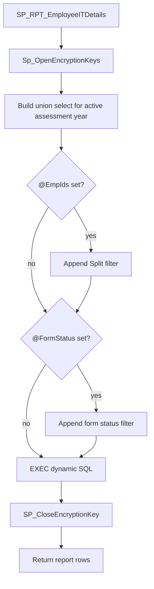

# SP_RPT_EmployeeITDetails

## What it does

Returns one row per employee for the active assessment year’s Income Tax Declaration report. Employees who already have a `TEmpIncomeTaxDet` row for the active year appear as `Completed` (`ActualSubmitted = 'Y'`) or `Estimated` (otherwise). Active employees with no declaration row for that year appear as `Pending`. Results are scoped to `@EmployerId`, optionally filtered by employee id CSV and/or form status, and ordered by employment number. The body opens and closes encryption keys, then runs a constructed dynamic SQL batch.

## Parameters

| Name | Direction | What it is for |
|---|---|---|
| `@EmployerId` | in | Employer whose employees are included |
| `@EmpIds` | in | Optional CSV of employee ids; when set, restricts to those ids via `dbo.Split` |
| `@FormStatus` | in | Optional status filter (`Completed`, `Estimated`, or `Pending`) |

## Call sequence

## Callers

| Object | Kind | Page |
|---|---|---|
| `IncomeTaxDeclarationDAL.GetITReport` | app | [PayRoll Report](/docs/guides/payroll/report) (`GET /IncomeTax/GetITReport`) |

No other procedure or function in `STOREPROCEDURE/` or `FUNCTIONS/` executes this object by name.

## Nested

| Object | Kind | When | Page |
|---|---|---|---|
| `Sp_OpenEncryptionKeys` | procedure | always, before dynamic SQL | [Sp_OpenEncryptionKeys](/docs/database/hrms/Sp_OpenEncryptionKeys) |
| `Fn_GetEmployeeName` | function | in the dynamic select for employee display name | [Fn_GetEmployeeName](/docs/database/hrms/Fn_GetEmployeeName) |
| `Split` | function | when `@EmpIds` is not null | [Split](/docs/database/hrms/Split) |
| `SP_CloseEncryptionKey` | procedure | always, after dynamic SQL | [SP_CloseEncryptionKey](/docs/database/hrms/SP_CloseEncryptionKey) |

## Steps

From `HRMS-DATABASE/HRMS/STOREPROCEDURE/SP_RPT_EmployeeITDetails.sql`:

1. `EXEC [dbo].Sp_OpenEncryptionKeys`.
2. Build `@sql` as a `SELECT DISTINCT` over a union:
   - First arm — join `TEmpIncomeTaxDet`, `TEmployee`, `TEmployeeInfo` for rows whose `assessmentid` is the active `tassessmentYear`; map `ActualSubmitted` to `Completed` / `Estimated`; resolve name via `Fn_GetEmployeeName` and year via `tassessmentYear`.
   - Second arm — active employees with no `TEmpIncomeTaxDet` row for the active assessment year; status `Pending`.
3. Append `WHERE a.Employerid = @EmployerId`.
4. When `@EmpIds` is not null, append `AND a.Employeeid IN (SELECT Data FROM dbo.Split(...))`.
5. When `@FormStatus` is not null, append `AND a.FormStatus = (...)`.
6. Append `ORDER BY employmentnumber`.
7. `EXEC (@sql)` to return the result set.
8. `EXEC SP_CloseEncryptionKey`.

## Tables

| Table | Read or write |
|---|---|
| `dbo.TEmpIncomeTaxDet` | read |
| `dbo.TEmployee` | read |
| `dbo.TEmployeeInfo` | read |
| `dbo.tassessmentYear` | read |

## Unresolved calls

- `EXEC (@sql)` — dynamic SQL batch built from `@EmployerId`, optional `@EmpIds`, and optional `@FormStatus`. Named callees inside the string (`Fn_GetEmployeeName`, `Split`) are listed under Nested; the batch itself is not a fixed object.

## Flow

