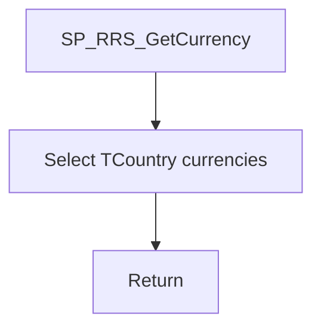

# SP_RRS_GetCurrency

## What it does

Returns currency id/code pairs from `TCountry` where `CURRENCYCODE` is not null, for recruitment currency dropdowns (including Donor Information Setup grant and allocated-amount pickers).

## Parameters

| Name | Direction | What it is for |
|---|---|---|
| — | — | No parameters |

## Call sequence

Calls no other procedures or functions.

## Callers

Application: Donor Information Setup `GetCurranciesNew` (`recruitmentDAL.js`) and other recruitment currency pickers. No other procedure or function calls this object.

## Nested

Calls no other procedures or functions.

## Steps

1. Select `ID` as `CurrencyId` and `CURRENCYCODE` as `CurrencyName` from `TCountry` where currency code is not null.

## Tables

| Table | Read or write |
|---|---|
| `TCountry` | read |

## Unresolved calls

None.

## Flow

