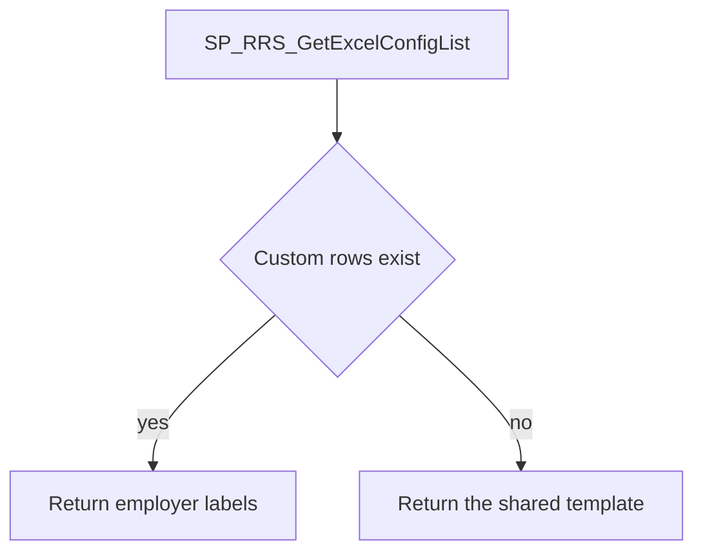

# SP_RRS_GetExcelConfigList

## What it does

Returns the RRS Excel column list for one employer and page. When that employer already has custom rows, it returns those labels. Otherwise it returns the shared template with `Selected` set to 1.

## Parameters

| Name | Direction | What it is for |
|---|---|---|
| `@EmployerId` | in | Organisation |
| `@RefPageId` | in | Page key. Defaults to 1. Recruitment Management sends 2 |

## Call sequence

Calls no other procedures or functions.

## Callers

No other procedure or function calls this object.

`recruitmentDAL.GetExcelConfigList` calls it from the RRS config panel.

## Nested

Calls no other procedures or functions.

## Steps

1. When `tref_rrs_excelConfig_custom` has rows for the employer and `@RefPageId`, select those rows and left-join `tref_rrs_excelConfig` on `ReferenceId` = `ID`, keeping the template's `RefPageId` (`SP_RRS_GetExcelConfigList.sql`).
2. `CustomLabel` is returned as `RowName`.
3. Otherwise select every template row for `@RefPageId` and add `Selected` = 1.

## Tables

| Table | Read or write |
|---|---|
| `tref_rrs_excelConfig_custom` | read |
| `tref_rrs_excelConfig` | read |

## Flow

