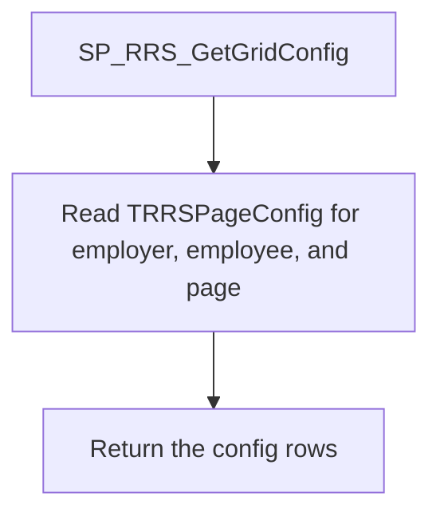

# SP_RRS_GetGridConfig

## What it does

Returns saved recruitment grid settings for one employee, employer, and page name. Set Interview Template calls it with page name `setInterviewQuestion_Grid` and reads the row whose `ConfigType` is `GridFormat`.

## Parameters

| Name | Direction | What it is for |
|---|---|---|
| `@EmployerId` | in | Organisation on the config row. Optional, default null |
| `@EmployeeId` | in | Employee on the config row. Optional, default null |
| `@GridId` | in | Compared to `TRRSPageConfig.PageName`. Optional, default null |

## Call sequence

Calls no other procedures or functions.

## Callers

No other procedure or function calls this object. `recruitmentDAL.GetGridConfig` calls it for `GET /api/recruitment/getGridConfig`.

## Nested

Calls no other procedures or functions.

## Steps

1. Select every column from `TRRSPageConfig` where `EmployerId`, `EmployeeId`, and `PageName` equal the three parameters (`SP_RRS_GetGridConfig.sql`).

## Tables

| Table | Read or write |
|---|---|
| `TRRSPageConfig` | read |

## Flow

