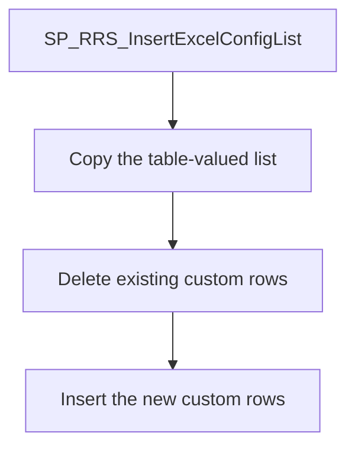

# SP_RRS_InsertExcelConfigList

## What it does

Replaces one employer's RRS Excel column overrides for a page. It deletes the existing custom rows for that employer and page, then inserts the table-valued list.

## Parameters

| Name | Direction | What it is for |
|---|---|---|
| `@EmployerId` | in | Organisation |
| `@EmployeeId` | in | Stored as `CreatedBy` |
| `@ConfigList` | in | `UDT_TRRSExcelConfigList` of reference id, selected, mandatory, label, and page |
| `@RefPageId` | in | Page whose custom rows are replaced. This screen sends 2 |

## Call sequence

Calls no other procedures or functions.

## Callers

No other procedure or function calls this object.

`recruitmentDAL.InsertExcelConfigList` calls it from the RRS config panel.

## Nested

Calls no other procedures or functions.

## Steps

1. Copy `@ConfigList` into `@Lv_TempExcelConfigTab` (`SP_RRS_InsertExcelConfigList.sql`).
2. Delete `tref_rrs_excelConfig_custom` for `@EmployerId` and `@RefPageId`.
3. Insert employer, reference id, selected, mandatory, creator, current time, `CustomLabel`, and `RefPageId` from the temp table.

## Tables

| Table | Read or write |
|---|---|
| `tref_rrs_excelConfig_custom` | write |

## Flow

