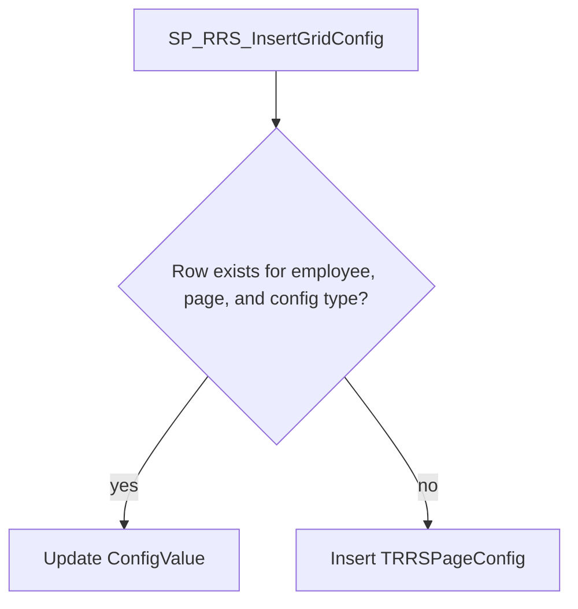

# SP_RRS_InsertGridConfig

## What it does

Saves one recruitment grid setting. When a row already exists for the employee, page name, and config type, it replaces `ConfigValue`. Otherwise it inserts a new `TRRSPageConfig` row.

## Parameters

| Name | Direction | What it is for |
|---|---|---|
| `@EmployerId` | in | Organisation stored on an insert. Optional, default null. The existence check does not use it |
| `@EmployeeId` | in | Employee whose setting is saved. Optional, default null |
| `@PageName` | in | Grid id, such as `setInterviewQuestion_Grid`. Optional, default null |
| `@ConfigType` | in | Setting kind, such as `GridFormat`. Optional, default null |
| `@ConfigValue` | in | Setting text. The DAL passes the column list as JSON. Optional, default null |

## Call sequence

Calls no other procedures or functions.

## Callers

No other procedure or function calls this object. `recruitmentDAL.SetGridConfig` calls it inside a DAL transaction for `POST /api/recruitment/setGridConfig`.

## Nested

Calls no other procedures or functions.

## Steps

1. When `TRRSPageConfig` has a row for `@EmployeeId`, `@PageName`, and `@ConfigType`, update that row's `ConfigValue` (`SP_RRS_InsertGridConfig.sql`).
2. Otherwise insert `PageName`, `EmployerId`, `ConfigValue`, `EmployeeId`, and `ConfigType`.

## Tables

| Table | Read or write |
|---|---|
| `TRRSPageConfig` | read and write |

## Flow

