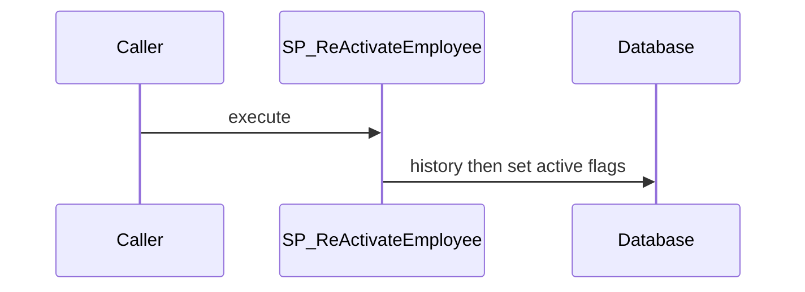
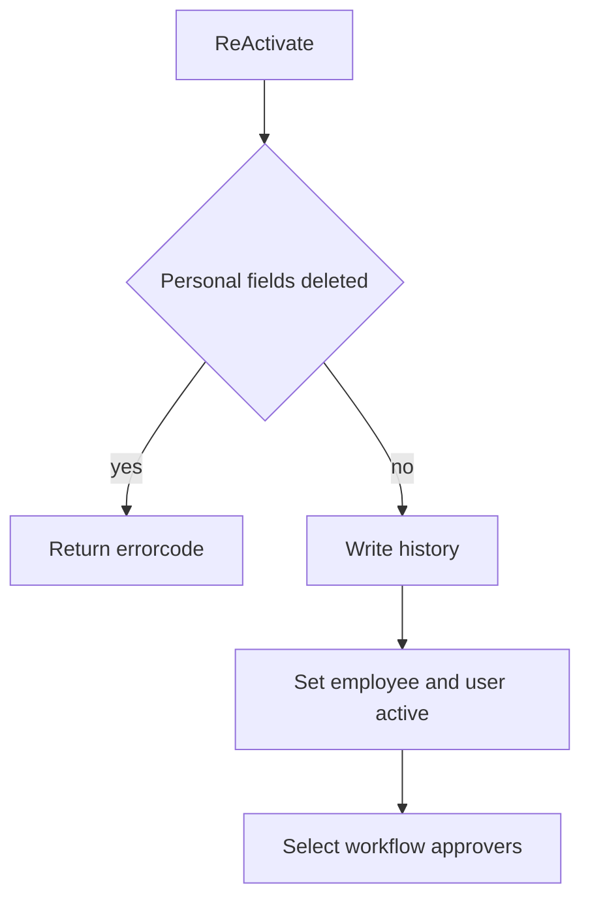

# SP_ReActivateEmployee

## What it does

Reactivates an inactive employee when personal fields have not been purged. Snapshots history, sets `TEmployee` / `TUsers` active, clears last-working / deactivation fields on `TEmployeeInfo`, and returns workflow approver rows (plus an errorcode recordset when personal data was deleted).

## Parameters

| Name | Direction | What it is for |
|---|---|---|
| `@empID` | in | Employee to reactivate |
| `@Reactiveatedby` | in | Authorised signatory employee id |
| `@reactivationdate` | in | Effective reactivation date |
| `@reactivationcomment` | in | HR comment |
| `@WorkflowId` | in | Workflow used for notifications |
| `@ModifiedBy` | in | Acting employee |

## Call sequence

## Callers

Application caller: Search Employee reactivate dialog → Operation API → `reactivateEmployee.js`.

## Nested

None (inline DML only).

## Steps

1. Script is `HRMS-DATABASE/HRMS/STOREPROCEDURE/SP_ReActivateEmployee.sql`.
2. If `IsPersonalFieldsDeleted = 'Y'`, return the deleted-personal-info error path.
3. Otherwise insert history for employee / info / org chart / user, set active flags, clear last working date, stamp reactivation fields.
4. Select approver notification rows from workflow routing.

## Tables

| Table | Read or write |
|---|---|
| `dbo.TEmployee` | read and write |
| `dbo.TEmployeeHistory` | write |
| `dbo.TEmployeeInfo` / `TEmployeeInfoHistory` | read and write |
| `dbo.TORGChart` / `TORGChartHistory` | read and write |
| `dbo.TUsers` / `TUsersHistory` / `TUserEmployee` | read and write |
| `dbo.TWorkflowDetails` | read |

## Flow

