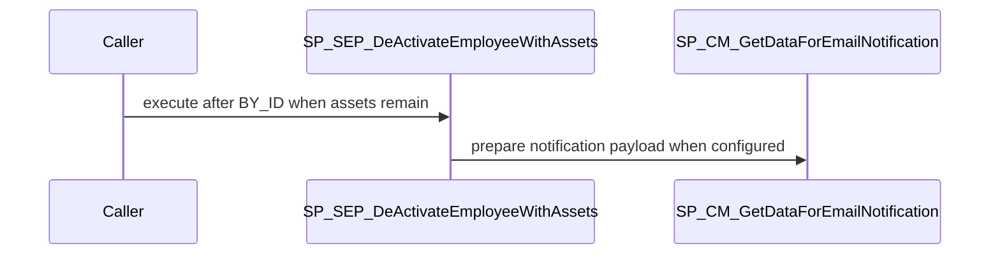
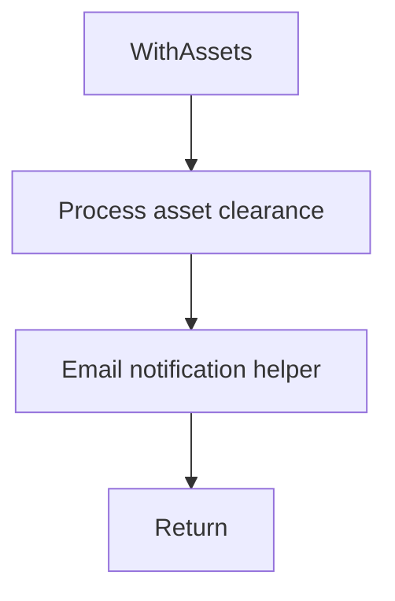

# SP_SEP_DeActivateEmployeeWithAssets

## What it does

Follow-up deactivation path used when the employee still has allocated assets. Runs after `SP_SEP_DeActivateEmployee_BY_ID` when the Search Employee / Operation UI confirms asset handling. Writes asset-related separation outcomes and can queue email notification data.

## Parameters

Mirrored deactivation inputs (employee, last working date, comments, workflow, updated-by, and related separation fields) as bound by `ORM/Data/deactivateEmployeeWithAssets.js`.

## Call sequence

## Callers

Application caller: Operation API `POST /api/employees/{id}/deactivate-with-assets` via `deactivateEmployeeWithAssets.js`, triggered from Search Employee’s deactivate dialog when assets block the first call.

## Nested

| Object | Kind | When | Page |
|---|---|---|---|
| `SP_CM_GetDataForEmailNotification` | procedure | email payload assembly | [SP_CM_GetDataForEmailNotification](/docs/database/hrms/SP_CM_GetDataForEmailNotification) |

## Steps

1. Script is `HRMS-DATABASE/HRMS/STOREPROCEDURE/SP_SEP_DeActivateEmployeeWithAssets.sql`.
2. Open encryption keys.
3. Apply asset-aware deactivation / clearance updates for the employee.
4. Optionally `EXEC SP_CM_GetDataForEmailNotification`.
5. Close encryption keys.

## Tables

| Table | Read or write |
|---|---|
| `dbo.TEmployee` / related separation tables | read and write |
| Employee asset tables referenced by the script | read and write |

## Flow

