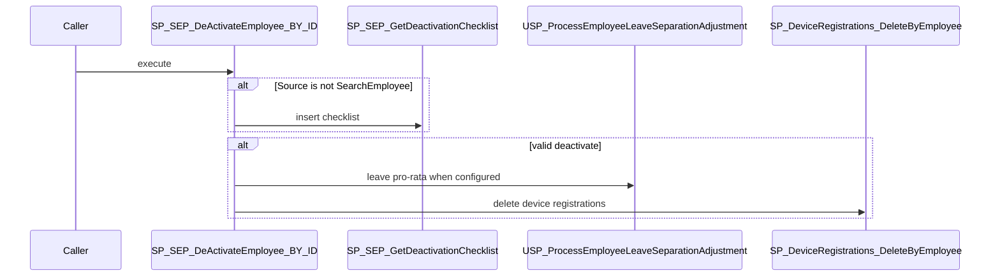
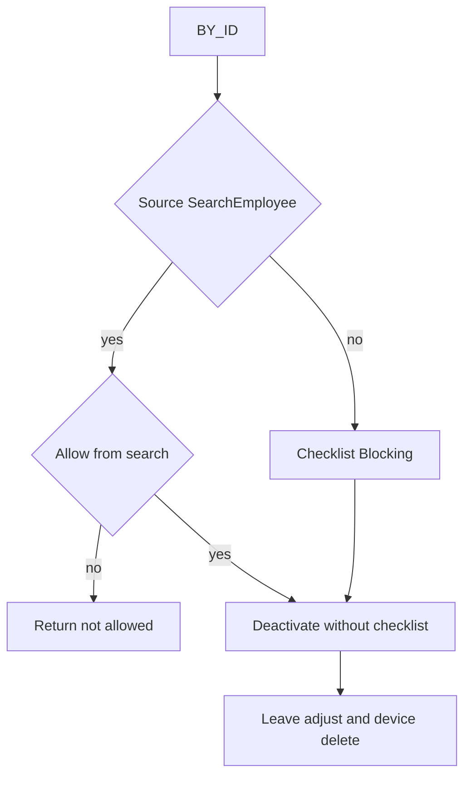

# SP_SEP_DeActivateEmployee_BY_ID

## What it does

Deactivates one employee (history snapshots, `TEmployee` / `TUsers` inactive, resignation / workflow side effects). When `@Source = 'SearchEmployee'`, skips the pending-activity checklist and instead requires `TCustomerSettings.IsAllowDeactivationFromSearchEmployee = 1`. Other sources run `SP_SEP_GetDeactivationChecklist` and block on Blocking rows. On success can adjust leave and delete device registrations.

## Parameters

| Name | Direction | What it is for |
|---|---|---|
| `@TransactionType` | in | `DEACTIVATE` / related transaction labels |
| `@EmpID` | in | Employee to deactivate |
| `@TerminationDate` | in | Optional termination date |
| `@LastWorkingDate` | in | Last working date |
| `@AuthorisedSignatoryEmpId` | in | Authorised signatory |
| `@IsExitInterviewDone` | in | Exit interview flag |
| `@DeactivationComments` | in | HR comments |
| `@SeparationTypeId` | in | Separation type |
| `@ResignationReason` | in | Resignation reason |
| `@ContractEndDate` | in | Optional |
| `@RetirementDate` | in | Optional |
| `@NoticePeriodEndDate` | in | Optional |
| `@RedundancyDate` | in | Optional |
| `@ResignationTypeDetails` | in | Other-reason text |
| `@workflowId` | in | Workflow id |
| `@UpdatedBy` | in | Acting employee |
| `@AutoDeactivate` | in | Auto path flag |
| `@ResignationDetailId` | in | Existing resignation detail |
| `@IsBulkDeActivated` | in | Bulk flag (Search uses 0) |
| `@Source` | in | Calling screen (`SearchEmployee` skips checklist) |

## Call sequence

## Callers

Application caller: Search Employee / Operation API `deactivateEmployee` (`ORM/Data/deactivateEmployee.js`). Also used by Separation screens with a different `@Source`.

## Nested

| Object | Kind | When | Page |
|---|---|---|---|
| `SP_SEP_GetDeactivationChecklist` | procedure | `@Source` not `SearchEmployee` | [SP_SEP_GetDeactivationChecklist](/docs/database/hrms/SP_SEP_GetDeactivationChecklist) |
| `USP_ProcessEmployeeLeaveSeparationAdjustment` | procedure | successful deactivate leave path | [USP_ProcessEmployeeLeaveSeparationAdjustment](/docs/database/hrms/USP_ProcessEmployeeLeaveSeparationAdjustment) |
| `SP_DeviceRegistrations_DeleteByEmployee` | procedure | successful deactivate cleanup | [SP_DeviceRegistrations_DeleteByEmployee](/docs/database/hrms/SP_DeviceRegistrations_DeleteByEmployee) |

## Steps

1. Script is `HRMS-DATABASE/HRMS/STOREPROCEDURE/123464_SP/SP_SEP_DeActivateEmployee_BY_ID.sql`.
2. Open encryption keys; resolve user / recruiter / employer for `@EmpID`.
3. If `@Source = SearchEmployee` and customer setting disallows search deactivation, return and stop.
4. Unless `@Source = SearchEmployee`, run checklist and collect Blocking activities.
5. On valid `DEACTIVATE`, write history, mark employee/user inactive, record resignation/workflow data, optionally adjust leave and delete devices.

## Tables

| Table | Read or write |
|---|---|
| `dbo.TCustomerSettings` | read |
| `dbo.TEmployee` | read and write |
| `dbo.TEmployeeHistory` | write |
| `dbo.TEmployeeInfo` | read and write |
| `dbo.TUsers` / `dbo.TUserEmployee` | read and write |
| `dbo.TResignationDetails` | read and write |

## Flow

