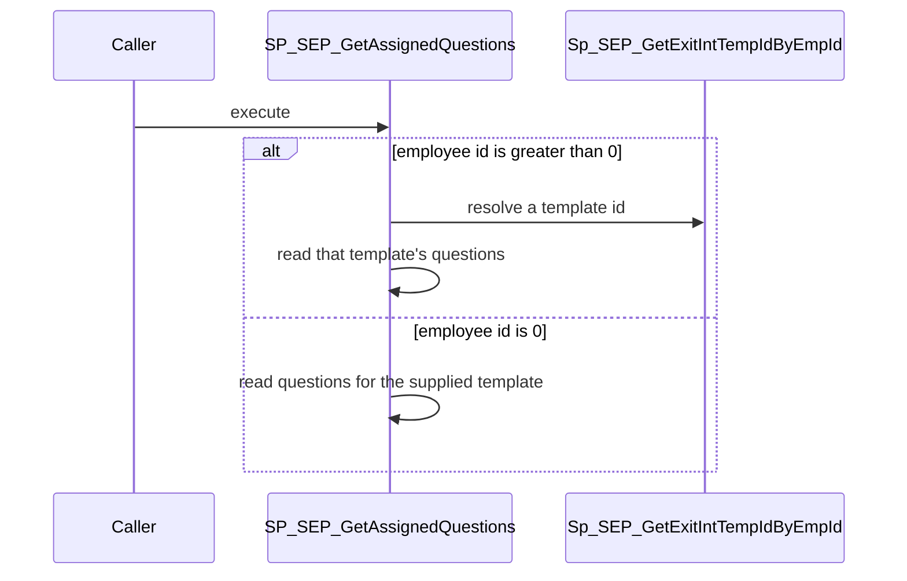
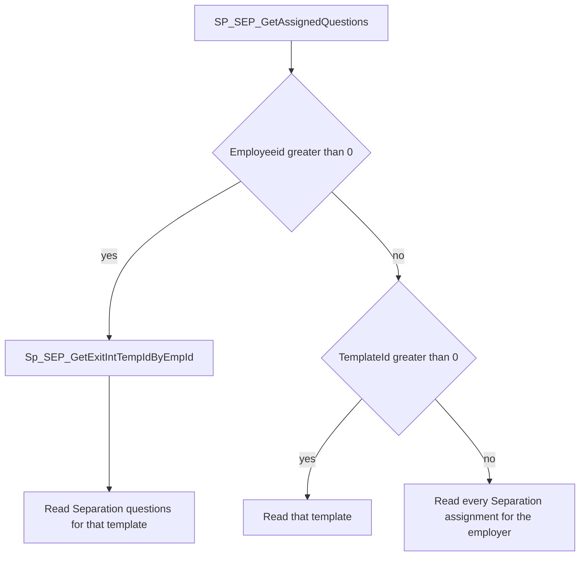

# SP_SEP_GetAssignedQuestions

## What it does

Returns active questionnaire rows that are assigned through a Separation template-module category. When `@Employeeid` is 0 and `@TemplateId` is greater than 0, it returns that template's questions. When `@Employeeid` is 0 and `@TemplateId` is not greater than 0, it returns every such question for the organisation. When `@Employeeid` is greater than 0, it first resolves one template id for that employee and then returns that template's questions. Question text is prefixed with a row number and a period. The script drops the procedure and creates it again.

## Parameters

| Name | Direction | What it is for |
|---|---|---|
| `@TemplateId` | in | Template to read when the employee id is 0 |
| `@Employerid` | in | Organisation on the question, category, and module link |
| `@Employeeid` | in | When greater than 0, the template id comes from the employee. Default 0 |

## Call sequence

## Callers

No other procedure or function calls this object.

`ResignationDAL.GetAssignedQuestions` calls it from Assign Question Template and passes employee id 0. That caller is application code, not a procedure.

## Nested

| Object | Kind | When | Page |
|---|---|---|---|
| `Sp_SEP_GetExitIntTempIdByEmpId` | procedure | when `@Employeeid` is greater than 0 | [Sp_SEP_GetExitIntTempIdByEmpId](/docs/database/hrms/Sp_SEP_GetExitIntTempIdByEmpId) |

## Steps

1. When `@Employeeid` is 0 and `@TemplateId` is greater than 0, select the question, its control settings, `TemplateId`, and a row number (`SP_SEP_GetAssignedQuestions.sql`).
2. Join `TQuestionnaireMaster` to `TAssignedQuestions` on `QuestionnaireId = QuestionId`.
3. Join `TTemplateModuleCategory` on `TemModCategoryId` and the same employer, then `TTemplateModule` on `TemplateModuleId` and the same employer, then `THrmsModules` where `ModuleName` is `Separation`.
4. Keep active questions for `@Employerid` and that `@TemplateId`. Order by `createdate`.
5. When `@Employeeid` is 0 and `@TemplateId` is not greater than 0, use the same joins without a template filter. Order by `Transid`.
6. When `@Employeeid` is greater than 0, insert the result of `Sp_SEP_GetExitIntTempIdByEmpId` into `@Template`, then use the same joins for the top template id in that table. Order by `Transid`.

A commented predicate `c.ModuleId = 13` is not applied. The live filter is the module name.

## Tables

| Table | Read or write |
|---|---|
| `TQuestionnaireMaster` | read |
| `TAssignedQuestions` | read |
| `TTemplateModuleCategory` | read |
| `TTemplateModule` | read |
| `THrmsModules` | read |

`TResignationDetails` and `TTerminationDetail` are read only inside `Sp_SEP_GetExitIntTempIdByEmpId`, and only on the employee branch.

## Flow

