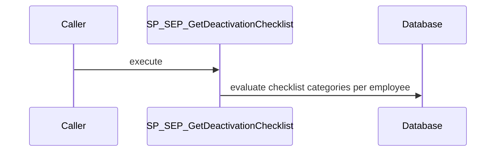
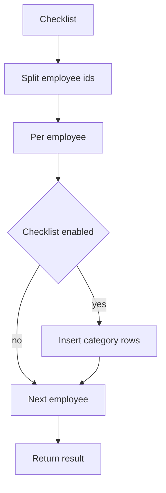

# SP_SEP_GetDeactivationChecklist

## What it does

Builds the config-aware pending-activity checklist for one or more employee ids (comma-separated). Categories cover employment/org dependencies, leave/attendance, workflows, assets, and related blocks. Rows include `Classification` (`Blocking` / informational). Search Employee deactivation with `@Source = SearchEmployee` does **not** call this procedure.

## Parameters

| Name | Direction | What it is for |
|---|---|---|
| `@EmployeeIds` | in | Comma-separated employee ids |

## Call sequence

## Callers

Nested from `SP_SEP_DeActivateEmployee_BY_ID` when `@Source` is not `SearchEmployee`. Also used by Separation deactivation UIs that surface the checklist directly.

## Nested

Reads many transactional tables per category; no further stored-procedure nest documented in the opening of the script (large inline checklist).

## Steps

1. Script is `HRMS-DATABASE/HRMS/STOREPROCEDURE/123464_SP/SP_SEP_GetDeactivationChecklist.sql`.
2. Split `@EmployeeIds` into a work table.
3. Per employee, skip when `IsDeactivationChecklistEnabled` is off for the employer.
4. Insert category rows (reporting manager, open requests, assets, etc.) into the result table.
5. Return the checklist result set.

## Tables

| Table | Read or write |
|---|---|
| `dbo.TEmployee` / `dbo.TEmployeeInfo` | read |
| `dbo.TCustomerSettings` | read |
| `dbo.TORGChart` | read |
| Multiple request / asset / leave tables | read |

## Unresolved calls

Category inserts reference a wide set of feature tables; treat the SQL script as authoritative for the full inventory.

## Flow

