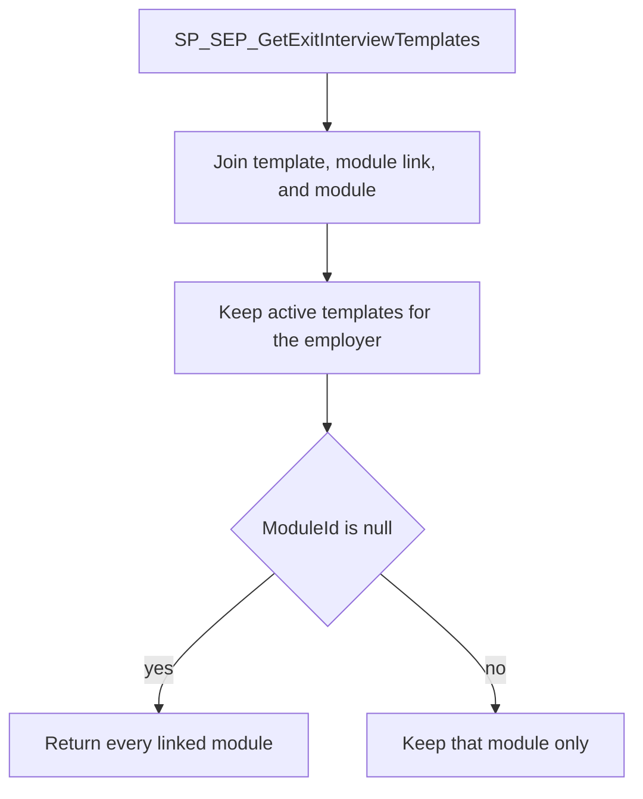

# SP_SEP_GetExitInterviewTemplates

## What it does

Returns active, not-deleted exit interview templates for one organisation, with the module each template is linked to. The header comment records a 4 July 2018 change for predictive search. When `@ModuleId` is null, the module filter is skipped and every linked module is returned. The script drops the procedure and creates it again.

## Parameters

| Name | Direction | What it is for |
|---|---|---|
| `@Employerid` | in | Organisation whose templates are read |
| `@ModuleId` | in | Module to keep. Default in the signature is 8. Null skips the filter |

## Call sequence

Calls no other procedures or functions.

## Callers

No other procedure or function calls this object.

`CommonDAL.GetTemplateList` calls it from Assign Question Template and passes `ModuleId` null. That caller is application code, not a procedure.

## Nested

Calls no other procedures or functions.

## Steps

1. Select `transid`, `TemplateName`, `IsActive` as `TemplateStatus`, `ModuleName`, `ModuleId`, `TemplateModuleId`, `Isdeleted`, and `Employerid` (`SP_SEP_GetExitInterviewTemplates.sql`).
2. Join `TExitInterviewTemplate` to `TTemplateModule` on `Transid = TemplateId` and the same employer.
3. Join `THrmsModules` on `ModuleId`.
4. Keep rows where the template is active (`IsActive = 1`), the employer matches, and `Isdeleted = 0`.
5. When `@ModuleId` is not null, also require that module on both `THrmsModules` and `TTemplateModule`.
6. Order by `transid`.

## Tables

| Table | Read or write |
|---|---|
| `TExitInterviewTemplate` | read |
| `TTemplateModule` | read |
| `THrmsModules` | read |

## Flow

