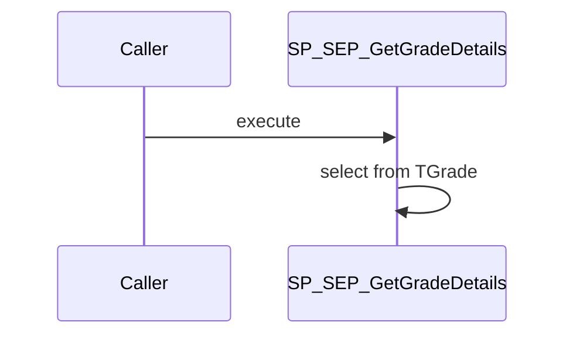
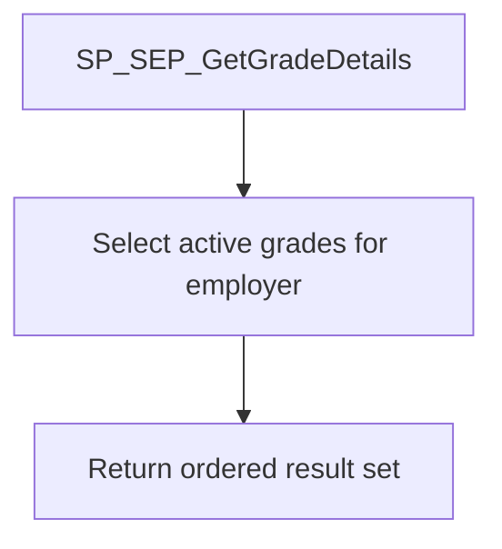

# SP_SEP_GetGradeDetails

## What it does

Returns active grade rows for one employer from `TGrade`. The display `GradeName` concatenates grade name and grade band when the band is non-empty; otherwise it is the grade name alone. Results are ordered by that display name.

## Parameters

| Name | Direction | What it is for |
|---|---|---|
| `@Employerid` | in | Employer whose active grades to return |

## Call sequence

Calls no other procedures or functions.

## Callers

| Object | Kind | Page |
|---|---|---|
| `Sp_Mydetails_Enhanced_Advancedfilerdropdown` | procedure | No page yet |

`EmployeeDal.GetGradeDetails` also executes it from Employee Bulk Update (`EmployeeBulkUpdate.aspx.cs`) and other screens.

## Nested

Calls no other procedures or functions.

## Steps

From `HRMS-DATABASE/HRMS/STOREPROCEDURE/SP_SEP_GetGradeDetails.sql`:

1. Select `GradeId`, concatenated `GradeName`, `GradeDesc`, `GradeBand`, audit columns, and `Employerid` from `TGrade` where `IsActive = 1` and `Employerid = @Employerid`.
2. Order by `GradeName`.

## Tables

| Table | Read or write |
|---|---|
| `dbo.TGrade` | read |

## Flow

