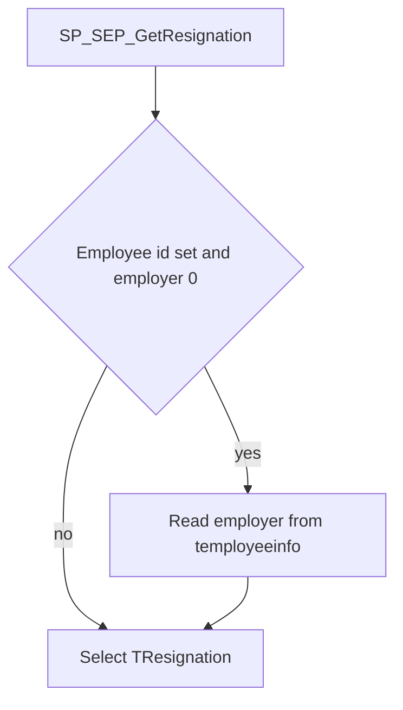

# SP_SEP_GetResignation

## What it does

Returns resignation reasons for one employer: `ResignationId`, `ResignationDescription`, and `IsActive`, ordered by description. The Master Setup grid calls it with `@EmployerId`. When `@Employeeid` is set and `@EmployerId` is 0, the procedure first reads that employee's employer from `temployeeinfo` and then runs the same list.

## Parameters

| Name | Direction | What it is for |
|---|---|---|
| `@Employeeid` | in | Optional. Used only to resolve an employer when `@EmployerId` is 0. Default 0 |
| `@EmployerId` | in | Employer whose reasons are listed. Default 0 |

## Call sequence

Calls no other procedures or functions.

## Callers

No other procedure or function calls this object.

## Nested

Calls no other procedures or functions.

## Steps

1. When `@Employeeid` is greater than 0 and `@EmployerId` is 0, set `@EmployerId` from `temployeeinfo` for that employee.

2. Select `ResignationId`, `ResignationDescription`, and `IsActive` from `TResignation` where `Employerid` matches, ordered by `ResignationDescription`. Both branches run that same select.

## Tables

| Table | Read or write |
|---|---|
| `temployeeinfo` | read, only when resolving the employer from an employee id |
| `TResignation` | read |

## Flow

