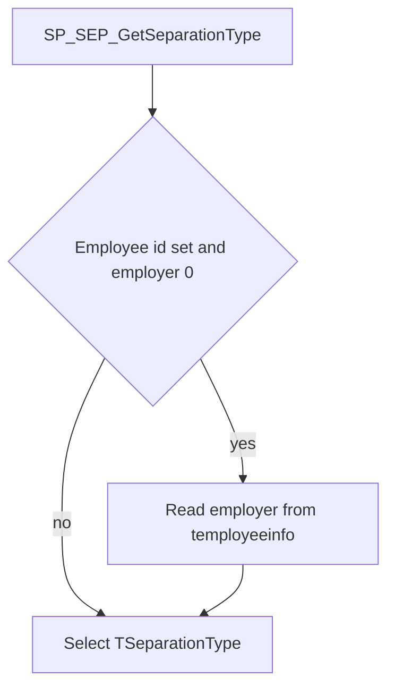

# SP_SEP_GetSeparationType

## What it does

Returns separation types for one employer: `SeparationTypeId`, `SeparationTypeDescription`, and `IsActive`, ordered by description. The Master Setup grid passes `@EmployerId`. When `@Employeeid` is set and `@EmployerId` is 0, the procedure first reads that employee's employer from `temployeeinfo`.

## Parameters

| Name | Direction | What it is for |
|---|---|---|
| `@Employeeid` | in | Optional. Used only to resolve an employer when `@EmployerId` is 0. Default 0 |
| `@EmployerId` | in | Employer whose separation types are listed. Default 0 |

## Call sequence

Calls no other procedures or functions.

## Callers

No other procedure or function calls this object.

## Nested

Calls no other procedures or functions.

## Steps

1. When `@Employeeid` is greater than 0 and `@EmployerId` is 0, set `@EmployerId` from `temployeeinfo`.

2. Select `SeparationTypeId`, `SeparationTypeDescription`, and `IsActive` from `TSeparationType` for that employer, ordered by description. The other branch selects the same columns without the employee lookup.

## Tables

| Table | Read or write |
|---|---|
| `temployeeinfo` | read, only when resolving the employer from an employee id |
| `TSeparationType` | read |

## Flow

