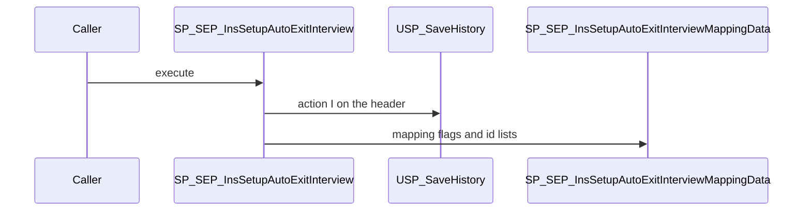
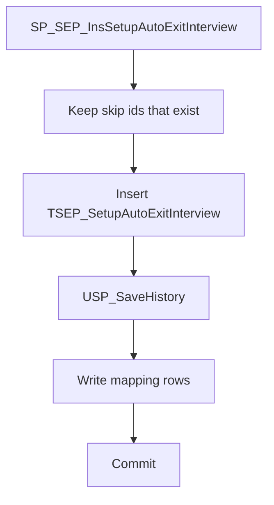

# SP_SEP_InsSetupAutoExitInterview

## What it does

Inserts one Setup Exit Interview rule and its mapping rows in one transaction. Skip-reason id lists are reduced to distinct ids that exist in `TResignation` and `TTerminationReason`. After the header insert, `USP_SaveHistory` records the header and `SP_SEP_InsSetupAutoExitInterviewMappingData` writes the designation, role, business-unit, location, employment-type, and email rows that the flags turn on. A failure rolls the transaction back.

## Parameters

| Name | Direction | What it is for |
|---|---|---|
| `@NoOfDays` | in | Number of days on the rule |
| `@ExitInterviewTempleteId` | in | Exit interview template id |
| `@IsBUMappingTypeExists` | in | Write business-unit mappings. Default 0 |
| `@IsRoleMappingTypeExists` | in | Write role mappings. Default 0 |
| `@IsLocationMappingTypeExists` | in | Write location mappings. Default 0 |
| `@IsDesignationMappingTypeExists` | in | Write designation mappings. Default 0 |
| `@IsEmploymentTypeMappingExist` | in | Write employment-type mappings. Default 0 |
| `@EmployeeTypeIds` | in | Comma-separated employment type ids |
| `@DesignationIds` | in | Comma-separated designation ids |
| `@RoleIds` | in | Comma-separated role ids. Optional |
| `@BusinessUnitIds` | in | Comma-separated business unit ids. Optional |
| `@LocationIds` | in | Comma-separated location ids. Optional |
| `@EmployerId` | in | Organisation |
| `@SendEmailForExitInterviewForm` | in | Send the form by email. Default 0 |
| `@EmailGroup` | in | Email group. Optional |
| `@EmailEmployee` | in | Employee ids for the email. Optional |
| `@CreatedBy` | in | Employee who saved the rule |
| `@ExitInterviewConductOn` | in | When the interview is conducted. Optional |
| `@EffectiveFrom` | in | Effective date. Optional |
| `@IsActive` | in | Active flag. Default 1 |
| `@IsRuleTriggeredByResignationReason` | in | Rule can be triggered by a resignation reason. Default 0 |
| `@IsRuleTriggeredByTerminationReason` | in | Rule can be triggered by a termination reason. Default 0 |
| `@SkipTriggerRuleForResignationReasonIds` | in | Resignation reason ids to skip. Optional |
| `@SkipTriggerRuleForTerminationReasonIds` | in | Termination reason ids to skip. Optional |

## Call sequence

## Callers

No other procedure or function calls this object.

## Nested

| Object | Kind | When | Page |
|---|---|---|---|
| `USP_SaveHistory` | procedure | after the header insert | No page yet |
| `SP_SEP_InsSetupAutoExitInterviewMappingData` | procedure | after history, in the same transaction | [SP_SEP_InsSetupAutoExitInterviewMappingData](/docs/database/hrms/SP_SEP_InsSetupAutoExitInterviewMappingData) |

`USP_SaveHistory` is executed by name. Its script is not in `HRMS-DATABASE`.

## Steps

1. Turn the skip lists into comma-separated distinct ids. A resignation id is kept only when it matches `TResignation.ResignationId`. A termination id is kept only when it matches `TTerminationReason.TerminationReasonID`. An empty list becomes null.

2. Begin a transaction and insert `TSEP_SetupAutoExitInterview` with the days, template, mapping flags, active flag, employer, email flag, conduct-on, effective date, trigger flags, and the normalised skip lists.

3. Execute `USP_SaveHistory` for `TSEP_SetupAutoExitInterview` / `TSEP_SetupAutoExitInterview_History` with action `I`.

4. Execute `SP_SEP_InsSetupAutoExitInterviewMappingData` with the mapping flags, id lists, email fields, the new id, and action `I`.

5. Commit. On error, roll back and rethrow.

## Tables

| Table | Read or write |
|---|---|
| `TResignation` | read, to keep only real resignation-reason ids |
| `TTerminationReason` | read, to keep only real termination-reason ids |
| `TSEP_SetupAutoExitInterview` | write |

Mapping tables are written by `SP_SEP_InsSetupAutoExitInterviewMappingData`.

## Flow

