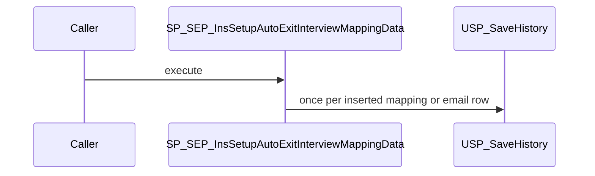
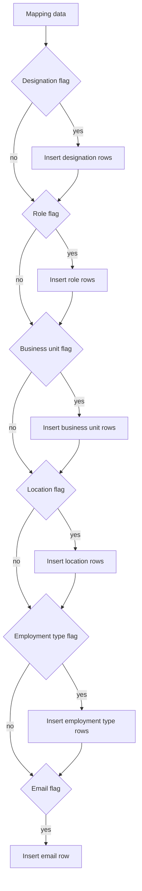

# SP_SEP_InsSetupAutoExitInterviewMappingData

## What it does

Writes the child rows for one Setup Exit Interview rule. Each mapping flag inserts one row per id in the matching comma-separated list, then calls `USP_SaveHistory` for that new id. When the email flag is on, it also inserts one email row. The parent passes action `I` on insert.

## Parameters

| Name | Direction | What it is for |
|---|---|---|
| `@IsBUMappingTypeExists` | in | Insert business-unit rows when 1. Default 0 |
| `@IsRoleMappingTypeExists` | in | Insert role rows when 1. Default 0 |
| `@IsLocationMappingTypeExists` | in | Insert location rows when 1. Default 0 |
| `@IsDesignationMappingTypeExists` | in | Insert designation rows when 1. Default 0 |
| `@IsEmploymentTypeMappingExist` | in | Insert employment-type rows when 1. Default 0 |
| `@EmployeeTypeIds` | in | Comma-separated employment type ids |
| `@DesignationIds` | in | Comma-separated designation ids |
| `@RoleIds` | in | Comma-separated role ids. Optional |
| `@BusinessUnitIds` | in | Comma-separated business unit ids. Optional |
| `@LocationIds` | in | Comma-separated location ids. Optional |
| `@SendEmailForExitInterviewForm` | in | Insert the email row when 1. Default 0 |
| `@EmailGroup` | in | Email group. Optional |
| `@EmailEmployee` | in | Employee ids stored on the email row. Optional |
| `@SetupAutoExitInterviewId` | in | Parent rule id |
| `@CreatedBy` | in | Employee passed to history |
| `@CURRENTDATE` | in | History timestamp supplied by the caller |
| `@ActionTypeId` | in | History action. Default `I` |

## Call sequence

## Callers

| Object | Kind | Page |
|---|---|---|
| `SP_SEP_InsSetupAutoExitInterview` | procedure | [SP_SEP_InsSetupAutoExitInterview](/docs/database/hrms/SP_SEP_InsSetupAutoExitInterview) |
| `SP_SEP_UPDSetupAutoExitInterview` | procedure | No page yet |

## Nested

| Object | Kind | When | Page |
|---|---|---|---|
| `USP_SaveHistory` | procedure | once for each inserted mapping id, and once for the email row | No page yet |

`USP_SaveHistory` is executed by name. Its script is not in `HRMS-DATABASE`. This pass does not write pages for anything `USP_SaveHistory` itself calls.

## Steps

1. When `@IsDesignationMappingTypeExists` is 1, split `@DesignationIds` and insert `TSEP_SetupAutoExitInterviewMappingForDesignation`. For each new id, execute `USP_SaveHistory` on `TSEP_SetupAutoExitInterviewMappingForDesignation`.

2. Do the same for roles (`TSEP_SetupAutoExitInterviewMappingForRole`), business units (`TSEP_SetupAutoExitInterviewMappingForBU`), locations (`TSEP_SetupAutoExitInterviewMappingForLocation`), and employment types (`TSEP_SetupAutoExitInterviewMappingForEmploymentType`) when the matching flag is 1.

3. When `@SendEmailForExitInterviewForm` is 1, insert `TSEP_SetupAutoExitInterviewEmail` with the group and employee ids, then execute `USP_SaveHistory` for that row.

## Tables

| Table | Read or write |
|---|---|
| `TSEP_SetupAutoExitInterviewMappingForDesignation` | write when the designation flag is 1 |
| `TSEP_SetupAutoExitInterviewMappingForRole` | write when the role flag is 1 |
| `TSEP_SetupAutoExitInterviewMappingForBU` | write when the business-unit flag is 1 |
| `TSEP_SetupAutoExitInterviewMappingForLocation` | write when the location flag is 1 |
| `TSEP_SetupAutoExitInterviewMappingForEmploymentType` | write when the employment-type flag is 1 |
| `TSEP_SetupAutoExitInterviewEmail` | write when the email flag is 1 |

## Flow

