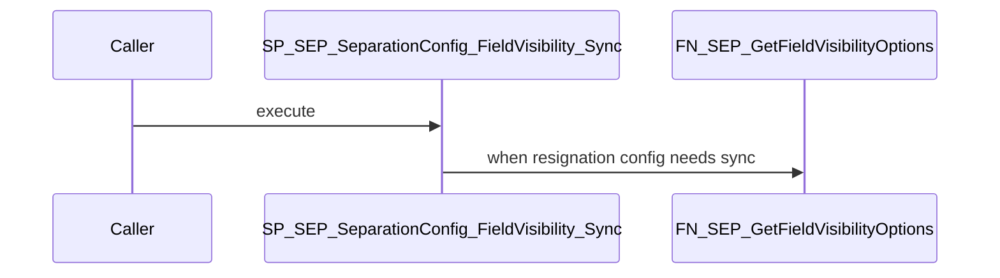
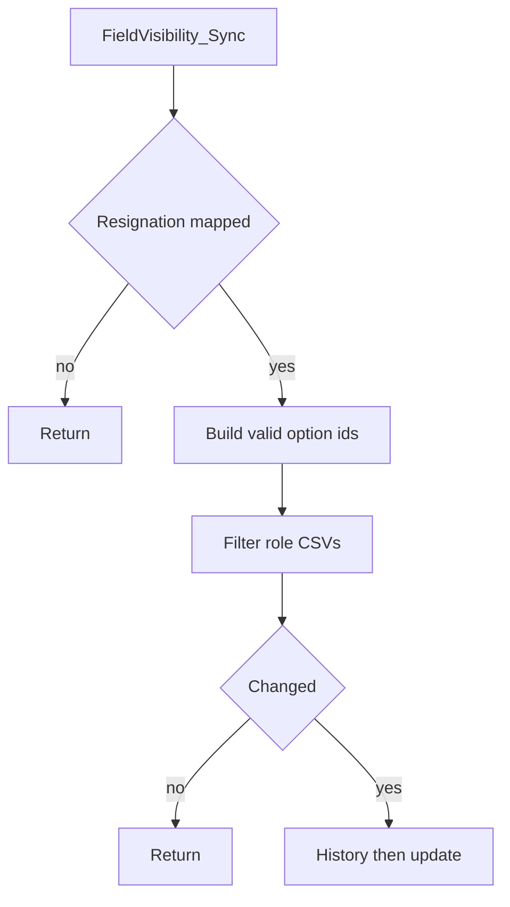

# SP_SEP_SeparationConfig_FieldVisibility_Sync

## What it does

For a resignation-mapped workflow, drops field-visibility authority ids from the active resignation configuration that are no longer valid for the employer's remaining resignation workflows. Valid ids come from `FN_SEP_GetFieldVisibilityOptions` plus fixed role sentinels. Writes history before updating `LeaveBalanceViewRole`, `RevisedLWDViewRole`, and `NoticePeriodLeavesViewRole`.

## Parameters

| Name | Direction | What it is for |
|---|---|---|
| `@WorkflowId` | in | Workflow that changed or was removed |

## Call sequence

## Callers

| Object | Kind | Page |
|---|---|---|
| `SP_AdminWM_RemoveDetailsById` | procedure | [SP_AdminWM_RemoveDetailsById](/docs/database/hrms/SP_AdminWM_RemoveDetailsById) |
| `SP_AdminWM_UpdDefinitionTreeDet` | procedure | No page yet |

## Nested

| Object | Kind | When | Page |
|---|---|---|---|
| `FN_SEP_GetFieldVisibilityOptions` | function | when building `#ValidIds` | No page yet |

## Steps

1. Resolve `ResignationDetails` `ModulePageId`; return if this workflow is not mapped to that page (`SP_SEP_SeparationConfig_FieldVisibility_Sync.sql`).
2. Load active resignation configuration field-visibility CSVs; return if none need pruning.
3. Build `#ValidIds` from `FN_SEP_GetFieldVisibilityOptions` plus fixed roles.
4. Recompute each CSV; if emptied, fall back to `-3` (Admin Role).
5. If unchanged, return; else insert history and update `TResignationConfigurationData`.

## Tables

| Table | Read or write |
|---|---|
| `TModulePages` | read |
| `TWorkflowManagement` | read |
| `TResignationConfigurationData` | read then write |
| `TResignationConfigurationData_History` | write |

## Flow

